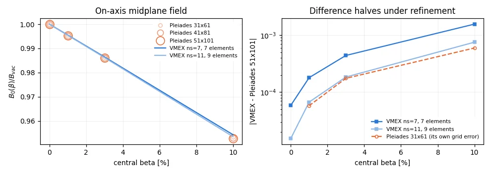

# VMEX

[](https://pypi.org/project/vmex/)
[](pyproject.toml)
[](LICENSE)
[](https://github.com/uwplasma/vmex/actions/workflows/ci.yml)
[](https://codecov.io/gh/uwplasma/vmex)
[](https://vmex.readthedocs.io/en/latest/)

VMEX is a JAX implementation of the VMEC equilibrium solver for three-dimensional ideal-MHD equilibria of stellarators and tokamaks. It reads VMEC input decks, solves fixed- and free-boundary equilibria (NESTOR vacuum field driven by an MGRID table or coils) and writes standard `wout_*.nc` files. Because the solver is written in JAX, it differentiates the converged equilibrium through the implicit function theorem, so boundary, profile and coil parameters can be optimized with derivatives of the discrete equilibrium equations.


What VMEX provides:

- **VMEC workflows:** `&INDATA` decks, JSON inputs, `NS_ARRAY` multigrid continuation, hot restart from a saved WOUT, and DESC inputs and outputs read without DESC.
- **Gradient-based design:** implicit scalar adjoints and residual Jacobians for SciPy, JAXopt or Optax, with quasisymmetry, quasi-isodynamic, piecewise-omnigenity, Mercier, ballooning, bootstrap and maximum-`J` objectives, and single-stage plasma and coil design.
- **Diagnostics:** Boozer transforms, the magnetic field and its first three derivatives, effective ripple, `--plot` summaries, `--scale` to reactor size, `--trace` alpha-particle losses, `--neoclassical` transport and `--turbulence` gyrokinetic runs.
- **Coils and free boundary:** ESSOS coil fields, MGRID tables and the virtual-casing exterior field of a finite-beta plasma.
- **Open mirrors:** a separate solver for axisymmetric and non-axisymmetric mirrors and stellarator-mirror hybrids.

The [capability reference](https://vmex.readthedocs.io/en/latest/reference/capabilities.html) defines the supported models and their validation limits.

## Installation

```console
pip install vmex
vmex --doctor
vmex --test
```

`pip install vmex` solves, plots, restarts, computes Boozer spectra and optimizes with SciPy. It depends on JAX (CPU), SciPy, netCDF4, h5py, [`solvax`](https://pypi.org/project/solvax/) (linear solvers) and [`booz_xform_jax`](https://pypi.org/project/booz_xform_jax/) (Boozer transform). `vmex --doctor` prints the interpreter, package versions and JAX devices; `vmex --test` solves a bundled QH deck and writes its figures to `./vmex_test/`.

Python 3.10 to 3.13 are tested; 3.12 or newer is recommended. The `coils`, `neoclassical`, `turbulence` and `all` extras need Python 3.11 or newer. Each extra adds one package and enables the features that need it:

```console
pip install "vmex[all]"
```

| Extra | Adds | Enables |
|---|---|---|
| `pip install "vmex[coils]"` | `essos` | coil fields, `--coils` free boundary, single-stage design, field-line and alpha tracing |
| `pip install "vmex[freeb]"` | `virtual-casing-jax` | the virtual-casing exterior field (`VmecExtender`) |
| `pip install "vmex[neoclassical]"` | `neo-jax`, `dkx` | effective ripple, `--plot` ripple panel, `--neoclassical` |
| `pip install "vmex[turbulence]"` | `gkx` | turbulence objectives and `--turbulence` |
| `pip install "vmex[optimizers]"` | `jaxopt`, `optax` | the JAXopt and Optax drivers |

The minimum versions are set in `pyproject.toml`; a package can also be installed by name:

| Package | Minimum | Installed by | Command |
|---|---|---|---|
| `solvax` | 0.36.1 | `pip install vmex` | `pip install "solvax>=0.36.1"` |
| `booz_xform_jax` | 0.5.1 | `pip install vmex` | `pip install "booz_xform_jax>=0.5.1"` |
| `essos` | 0.22.0 | `vmex[coils]` | `pip install "essos>=0.22.0"` |
| `virtual-casing-jax` | 0.0.15 | `vmex[freeb]` | `pip install "virtual-casing-jax>=0.0.15"` |
| `neo-jax` | 1.1.1 | `vmex[neoclassical]` | `pip install "neo-jax>=1.1.1"` |
| `dkx` | 2.14.0 | `vmex[neoclassical]` | `pip install "dkx>=2.14.0"` |
| `gkx` | 2.6.0 | `vmex[turbulence]` | `pip install "gkx>=2.6.0"` |

`import vmex` leaves `jax.config` unchanged. `vmex.configure()` sets float64, a persistent compilation cache, synchronous CPU dispatch and quiet JAX logging. The `vmex` command and the first import of `vmex.core` or `vmex.mirror` call it. The solver requires float64; a script that also runs other JAX code calls `vmex.configure()` once at the top. See the [installation guide](https://vmex.readthedocs.io/en/latest/installation.html) for GPU, conda-forge and WSL2.

## Quick start

```console
vmex input.my_case --plot                  # solve, write wout_my_case.nc and the diagnostic PNGs
vmex --plot wout_my_case.nc                # plot an existing WOUT
vmex --booz wout_my_case.nc                # Boozer spectrum
vmex --scale wout_my_case.nc               # rescale to reactor size
vmex --trace wout_my_case.nc               # alpha-particle losses
vmex --neoclassical wout_my_case.nc        # transport and bootstrap current
vmex input.nearby --restart wout_my_case.nc
vmex wout_my_case.nc --to-input            # write input.my_case
```

In Python:

```python
import vmex as vj

inp = vj.VmecInput.from_file("input.my_case")
result = vj.solve_multigrid(inp, verbose=True)       # follows NS_ARRAY, FTOL_ARRAY, NITER_ARRAY
print(result.converged, result.fsqr, result.fsqz, result.fsql)
vj.write_wout("wout_my_case.nc", vj.wout_from_result(inp, result))
```

Pass `initial_state=result.state` for a nearby solve or `restart_from=` for a saved WOUT. `vj.VmecInput.from_wout("wout_my_case.nc").to_indata("input.my_case")` rebuilds a deck from the final boundary, flux and profiles; the multigrid ladder is not recoverable and a free-boundary case also needs its MGRID file.

`vmex equilibrium.h5` reads DESC text inputs and HDF5/pickle outputs without DESC, writes `input.equilibrium` and solves it. `--desc-tol 0` keeps all boundary modes; the default 1% tolerance does not guarantee field accuracy.

`--plot` writes five PNGs: a summary (Boozer `|B|`, `J` map, `D_R`, force balance, effective ripple with `vmex[neoclassical]`), flux-surface cross-sections, `|B|` in VMEC angles, Mercier stability and the 3-D LCFS.

## Differentiate and optimize

```python
import jax
from vmex.core import implicit

params = implicit.params_from_input(inp)
gradient = jax.grad(lambda p: implicit.run(inp, p).aspect)(params)
```

A boundary optimization takes objectives as `(function, target, weight)` tuples and lets SciPy choose the steps:

```python
from scipy.optimize import least_squares
from vmex import optimize as opt

problem = opt.VmecProblem.from_tuples(
    inp, [(opt.aspect_ratio, 4.0, 1.0)], max_mode=1, use_ess=True)
fit = least_squares(
    problem.residual, problem.x0, jac=problem.residual_jac,
    x_scale=problem.scales, max_nfev=20)
problem.input_from_x(fit.x).to_indata("input.optimized")
vj.write_wout("wout_optimized.nc", problem.equilibrium_from_x(fit.x).wout)
```

`problem.value_and_grad` feeds scalar objectives to BFGS and L-BFGS-B, `problem.jax_value_and_grad` feeds JAX optimizers, and `problem.evaluate(x)` reports solve effort and derivative status. See the [gradient tutorial](https://vmex.readthedocs.io/en/latest/tutorials/first-gradient.html) and the [optimization guide](https://vmex.readthedocs.io/en/latest/howto/optimize-a-boundary.html).

The scripts in [examples/optimization](examples/optimization/) cover quasi-axisymmetric, quasi-helical, quasi-poloidal and quasi-isodynamic boundaries, piecewise omnigenity, bootstrap-consistent designs, asymmetric boundaries and single-stage plasma and coil design. Resolutions, weights and iteration budgets sit at the top of each script.

### Ballooning stability

The infinite-n ideal ballooning mode ([Dewar and Glasser 1983](https://doi.org/10.1063/1.864113), [Gaur et al. 2023](https://arxiv.org/abs/2302.07673)) is the eigenproblem along a field line,

$$
\frac{d}{d\eta}\Big(g\,\frac{dX}{d\eta}\Big) + c\,X = \lambda\,f\,X,\qquad X(\pm\eta_b)=0,
$$

with line bending `g`, pressure and curvature drive `c` and inertia `f > 0`. A line is unstable when its largest eigenvalue `λ = (γ a_N/v_A)²` is positive. VMEX discretizes it with finite differences, applies a Richardson step in the grid spacing, and differentiates the eigenvalue with Hellmann-Feynman, so `ballooning_residual` works as an implicit least-squares target. With COBRA's three-point radial stencil, four field lines of the finite-beta QA deck agree with COBRAVMEC within 1.7% (`tests/test_stability.py`). See [objectives](docs/reference/objectives.rst) and [stability theory](docs/explanation/confinement.rst).

## Coils, free boundary and the exterior field

The equilibrium exposes Cartesian `B()` and its first three derivatives, with VJPs, inside the plasma (`set_points_xyz`, `set_points_flux`). Outside, `vj.VmecExtender.from_file("wout_my_case.nc", external_field=coils.B)` adds the plasma's virtual-casing field to the coil field. Coil and MGRID fields enter free-boundary solves as `MgridField` (trilinear or tricubic).

```console
python examples/free_boundary_essos_coils.py       # beta ramp and Shafranov shift
python examples/vmex_get_B_outside_plasma.py       # exterior field
python examples/vmex_essos_tracing_to_wall.py      # guiding centres through the LCFS to a wall
```

Opt-in options, off by default to keep VMEC iteration parity: Newton anchoring (`vmex.solve_free_boundary_newton`), position control (`LPOSITION_CONTROL = T`), `vmex.relax_free_boundary_constraint` and `solve_multigrid(inp, lambda_m0_floor=1e-3)`. See the [free-boundary guides](https://vmex.readthedocs.io/en/latest/howto/free-boundary.html) and the [fields and coils guide](https://vmex.readthedocs.io/en/latest/howto/use-essos-fields-and-coils.html).

## Particle tracing, transport and turbulence

- `--trace` (needs `vmex[coils]`) traces fusion alphas in Boozer coordinates and writes the loss fraction, loss against time, loss maps and pitch and loss-time distributions. `--trace-particles N` and `--trace-tmax T` set the ensemble; cost grows as `N x T`. `--trace-birth volume` samples the D-T birth profile and `--collisional` adds slowing down and scattering ([guide](docs/howto/trace-alpha-particles.md)).
- `--neoclassical` (needs `vmex[neoclassical]`) computes monoenergetic coefficients, the ambipolar `E_r`, bootstrap current and fluxes with DKX, and compares the current with Redl; profiles come from `--nc-profiles` ([guide](docs/howto/neoclassical-transport.md)). `vmex.epsilon_effective_from_wout` returns the effective ripple.
- `--turbulence` (needs `vmex[turbulence]`) runs a gyrokinetic heat-flux proxy with GKX.

## Open mirrors

The mirror solver minimizes the same MHD energy with coordinates `(s, theta, xi)`: Fourier modes in `theta`, clamped cubic B-splines in `xi` between two end cuts, and a free boundary coupled to an open exterior vacuum problem. The field is divergence-free by construction. A stellarator-mirror hybrid closes two straight legs with curved stellarator returns.

```console
vmex examples/data/input.mirror_two_coil_free_boundary --plot   # a &MIRROR deck, writes mout_*.nc
```

```python
from vmex.mirror import MirrorInput, solve_mirror
solution = solve_mirror(MirrorInput.from_file("examples/data/input.mirror_two_coil_free_boundary"))
```

The [mirror guide](https://vmex.readthedocs.io/en/latest/howto/mirror-machines.html) lists the validated lanes.

## How VMEX works

1. **Energy principle.** VMEX finds a stationary point of `W = ∫ (B²/2μ₀ + p/(γ−1)) dV` over nested flux surfaces, where `J × B = ∇p`. The unknowns are the surface shapes `R`, `Z` and the angle function `λ`: Fourier series in both angles, finite differences in radius.
2. **Spectral force iteration.** Each iteration evaluates the Fourier-projected forces and takes a damped second-order Richardson step with VMEC2000's time-step control and restarts. A radial tridiagonal preconditioner per Fourier mode makes the step effective, and `NS_ARRAY` runs a coarse-to-fine multigrid ladder. The solve has converged when `FSQR`, `FSQZ` and `FSQL` fall below `FTOL`.
3. **Free boundary.** NESTOR solves the exterior Neumann problem for the vacuum potential, driven by an MGRID table or a coil field; pressure balance across the boundary moves the plasma surface.
4. **Implicit derivatives.** At a root `F(x, p) = 0` of the force residual, `dx/dp = −(∂F/∂x)⁻¹ ∂F/∂p`. A scalar objective needs one adjoint linear solve for all parameters, and least-squares Jacobians factor the block-tridiagonal radial operator once. The forward iterations are not recorded, so memory does not grow with their number. The derivative assumes the state is a root (a fixed boundary is first Newton-refined to `refine_tol = 1e-10`), that `∂F/∂x` is invertible and that perturbed solves stay on the same branch. It is the derivative of the discrete equations, not of the continuum problem.
5. **Virtual casing.** `VmecExtender` adds the field of the plasma currents, a surface integral over the boundary field, to the coil field outside the plasma; its error grows near the surface.

The [explanation pages](https://vmex.readthedocs.io/en/latest/explanation/index.html) derive each step.

## Force-balance polishing

A small `FSQR/FSQZ/FSQL` means the discrete solve converged, not that the continuous force `J × B − ∇p` is small. Polishing (`polish=True` or `--polish`) re-solves that force on a quintic spline and, for axisymmetric equilibria, certifies it with an independent oracle. A deck requests it with one comment line that VMEC2000 ignores:

```fortran
! VMEX: POLISH_FORCE_BALANCE = .TRUE.
```

Certification covers tokamaks with `NCURR = 0`, `GAMMA = 0` and `LASYM = F`; stellarators are polished without a certificate. `eps_F` is bounded above by 2 by construction and saturates in vacuum, so read it together with the dimensional metrics. Examples: `examples/force_balance_polishing.py` and `examples/prescribed_current_polishing.py`. See the [polishing reference](https://vmex.readthedocs.io/en/latest/explanation/high-order-force-balance.html) and the [validation record](docs/explanation/validation.md).

## Validation

- **VMEC2000 parity.** CI solves six decks against stored VMEC2000 output and requires `wb` within `1e-7` relative, `iota` and the `R`, `Z` harmonics on three surfaces within `1e-5`, and iteration counts within ±25%.
- **Derivatives.** CI compares adjoint gradients with central finite differences: four Solov'ev gradients to `1e-6` relative and a 3-D `li383` boundary gradient to `2e-4`.
- **Exact equilibria.** [vmex-benchmark-analytical](https://github.com/rogeriojorge/vmex-benchmark-analytical) scores VMEX against closed-form 3-D equilibria with finite pressure ([Landreman 2026](https://arxiv.org/abs/2609.26742), [Issan et al. 2026](https://arxiv.org/abs/2610.07304)); the bundled [checks](tests/test_exact_vacuum.py) recover the transform of exact nonsymmetric vacuum fields ([Sengupta et al. 2026](https://arxiv.org/abs/2610.28466)).
- **Mirrors.** The on-axis field of a two-coil free-boundary mirror agrees with an independent Green-function code to 7.5e-4 from vacuum to 10% beta.
- **Record.** The [validation record](docs/explanation/validation.md) lists every gate, tolerance and benchmark with the measured accuracy of each lane.



On-axis field of the two-coil mirror from vacuum to 10% beta (`docs/_static/figures/sources/make_mirror_pleiades_figure.py`).

## Performance and parallel execution

JAX compiles each solve once per array structure and reuses the executable for matching shapes, so measure first-call, cache-reload and warm costs separately, including refinement and gradients for optimization. The [performance reference](https://vmex.readthedocs.io/en/latest/reference/performance.html) and the [benchmark records](benchmarks/) hold the measurements.

Finite-difference probes use every available CPU; an exact-Jacobian run stays one process. `vj.parallel.solve_ensemble(inputs, workers=None)` solves independent cases concurrently and returns results in input order, each identical to a single solve. See the [ensemble guide](https://vmex.readthedocs.io/en/latest/howto/parallel-ensembles.html) and [running on CPU, GPU and whole nodes](https://vmex.readthedocs.io/en/latest/howto/run-on-gpu.html#running-on-cpu-gpu-and-whole-nodes).

## Running the examples

The examples live in the repository, not in the wheel:

```console
git clone --filter=blob:none https://github.com/uwplasma/vmex
cd vmex
pip install -e ".[all]"
vmex examples/data/input.circular_tokamak --plot
python examples/take_fixed_boundary_gradients.py
```

| Application | Starting point | Needs |
|---|---|---|
| Equilibrium | `vmex examples/data/input.circular_tokamak --plot`; decks in [examples/data](examples/data/) | core |
| Boundary design (QA, QH, QP, QI, pwO) | [examples/optimization](examples/optimization/) | core |
| JAXopt and Optax drivers | `QI_optimization_jaxopt.py`, `QI_optimization_optax.py` | `vmex[optimizers]` |
| Single-stage plasma and coils | `single_stage_optimization.py`, `single_stage_free_boundary_optimization.py` | `vmex[coils]` |
| Fields and derivatives | `python examples/vmex_get_B_gradB.py` | core |
| Exterior field | `python examples/vmex_get_B_outside_plasma.py` | `vmex[coils,freeb]` |
| Free boundary with ESSOS coils | `python examples/free_boundary_essos_coils.py` | `vmex[coils]` |
| Free boundary from an MGRID table | `python examples/free_boundary_mgrid.py` | core; first `python tools/fetch_assets.py --bundle reference-nc` |
| Effective ripple | `python examples/epsilon_effective.py` | `vmex[neoclassical]` |
| Independent-case ensembles | `python examples/parallel_ensemble_scan.py` | core |
| Open mirrors | `examples/mirror/` | core; the beta scan needs `vmex[coils]` |
| Force-balance polishing | `python examples/force_balance_polishing.py` | core |

## Documentation, development and citation

Start with [your first equilibrium](https://vmex.readthedocs.io/en/latest/tutorials/first-equilibrium.html) and [your first optimization](https://vmex.readthedocs.io/en/latest/tutorials/first-optimization.html), then the [API](https://vmex.readthedocs.io/en/latest/reference/api/basic.html), [VMEC compatibility](https://vmex.readthedocs.io/en/latest/reference/vmec2000-compatibility.html) and [troubleshooting](https://vmex.readthedocs.io/en/latest/howto/troubleshoot.html). For development, `pip install -e ".[dev]"` and `python tools/preflight.py --static`. Report issues with the input deck and `vmex --doctor` output. See [contributing](CONTRIBUTING.md), [citation](CITATION.cff) and [license](LICENSE).
