# VMEX

[](https://pypi.org/project/vmex/)
[](pyproject.toml)
[](LICENSE)
[](https://github.com/uwplasma/vmex/actions/workflows/ci.yml)
[](https://codecov.io/gh/uwplasma/vmex)
[](https://vmex.readthedocs.io/en/latest/)

VMEX is a JAX reimplementation of VMEC2000, the standard code for
three-dimensional ideal-MHD equilibria of stellarators and tokamaks. It reads
VMEC input decks, solves fixed- and free-boundary equilibria (NESTOR vacuum
field driven by an MGRID table or coils), reproduces VMEC2000's iteration
and writes standard `wout_*.nc` files. Because the solver is written in JAX,
VMEX also differentiates the converged equilibrium through the implicit
function theorem, so boundary, profile and coil parameters can be optimized
with derivatives of the discrete equilibrium equations.

The goal is fast, differentiable and VMEC2000-compatible equilibria for
stellarator optimization, including single-stage design, in which the plasma
boundary and the coils are optimized together. VMEX also computes Boozer
transforms, fields and their derivatives, quasisymmetry, quasi-isodynamicity
and stability diagnostics, and has a separate lane for open mirrors.

- **Use existing workflows:** VMEC input decks and `wout_*.nc` output, `NS_ARRAY` multigrid
  continuation, hot restart from a saved WOUT, and DESC inputs and outputs read without DESC.
- **Design with gradients:** implicit scalar adjoints and residual Jacobians for SciPy, JAXopt or
  Optax, with quasisymmetry, quasi-isodynamic, Mercier, ballooning, bootstrap and maximum-`J` objectives.
- **Inspect the physics:** Boozer transforms, the magnetic field and its first three spatial
  derivatives, effective ripple, the `--plot` diagnostic summary, `--scale` to reactor size,
  `--trace` alpha-particle losses and `--turbulence` gyrokinetic runs.
- **Choose the hardware:** CPU or GPU equilibrium solves (optimization gradients default to CPU),
  reusable compilation and independent-case ensembles.
- **Connect coils:** ESSOS coil fields, NESTOR free boundary from an MGRID table or coils, and the
  virtual-casing exterior field of a finite-beta plasma.


The [capability reference](https://vmex.readthedocs.io/en/latest/reference/capabilities.html)
defines supported models and validation limits. The toroidal model assumes nested flux surfaces;
mirror and high-order polishing features have narrower validation scopes.

## Installation

```console
pip install vmex
vmex --doctor
vmex --test
```

`pip install vmex` is enough to solve, plot, restart, compute Boozer spectra and optimize with SciPy.
Its required dependencies include JAX (CPU), SciPy, netCDF4 and h5py, and two uwplasma packages that
the solver itself calls: [`solvax`](https://pypi.org/project/solvax/) for the linear solvers (the
radial preconditioner, polishing least squares, GMRES) and
[`booz_xform_jax`](https://pypi.org/project/booz_xform_jax/) for the Boozer transform. `vmex --doctor`
prints the interpreter, package versions and JAX devices; `vmex --test` solves a bundled QH deck
end to end and writes its figures to `./vmex_test/`.

Python 3.11, 3.12 and 3.13 are tested. JAX 0.11 needs Python 3.12 or newer, so a 3.11 environment
resolves an older JAX; 3.12 or newer is recommended.

### Optional packages for the full capabilities

Each extra installs one more package from PyPI and turns on the features that need it. Install all
of them with

```console
pip install "vmex[all]"
```

or pick what you need:

| Install | Adds | Enables |
|---|---|---|
| `pip install "vmex[coils]"` | `essos>=0.22.0` | ESSOS coil fields, `vmex --coils` free boundary, single-stage plasma and coil optimization, field-line and alpha-particle tracing |
| `pip install "vmex[freeb]"` | `virtual-casing-jax>=0.0.9` | the virtual-casing exterior field of the plasma (`VmecExtender`) |
| `pip install "vmex[neoclassical]"` | `neo-jax>=1.0.6`, `dkx>=2.8.0` | effective ripple `ε_eff` from a WOUT or Boozer spectrum (`vmex.epsilon_effective_from_wout`), the `--plot` ripple panel and `vmex --neoclassical` |
| `pip install "vmex[turbulence]"` | `gkx>=2.6.0` (with `jax>=0.10.1`) | gyrokinetic turbulence-proxy objectives (`vmex.core.turbulence`) and `vmex --turbulence` |
| `pip install "vmex[optimizers]"` | `jaxopt`, `optax` | the JAXopt and Optax optimization drivers |
| `pip install "vmex[all]"` | all of the above | every example and documented workflow |

The same packages can be installed by name; the floors are the ones in `pyproject.toml`:

| Package | Minimum | Installed by | Command |
|---|---|---|---|
| `solvax` | 0.27.0 | `pip install vmex` | `pip install "solvax>=0.27.0"` |
| `booz_xform_jax` | 0.4.3 | `pip install vmex` | `pip install "booz_xform_jax>=0.4.3"` |
| `essos` | 0.22.0 | `vmex[coils]` | `pip install "essos>=0.22.0"` |
| `virtual-casing-jax` | 0.0.9 | `vmex[freeb]` | `pip install "virtual-casing-jax>=0.0.9"` |
| `neo-jax` | 1.0.6 | `vmex[neoclassical]` | `pip install "neo-jax>=1.0.6"` |
| `dkx` | 2.8.0 | `vmex[neoclassical]` | `pip install "dkx>=2.8.0"` |
| `gkx` | 2.6.0 | `vmex[turbulence]` | `pip install "gkx>=2.6.0"` |
| `jaxopt`, `optax` | none | `vmex[optimizers]` | `pip install jaxopt optax` |

### Existing environments

- Installing over an environment with older packages is supported. Every floor above, and the
  floors those packages declare (such as solvax's `equinox>=0.13.3`), upgrades an older copy. A
  nightly CI lane installs `vmex[all]` over a stale environment to keep this true.
- DESC (`desc-opt`) requires `jax<0.10`, so it needs its own environment. The same holds for other
  packages that cap JAX below 0.10: `vmex[turbulence]` and `vmex[all]` require `jax>=0.10.1`, so pip
  either upgrades JAX past their cap (with a warning) or cannot resolve.
- NESTOR free boundary from an MGRID table needs no extra.
- A feature whose package is missing raises an `ImportError` that names the package to install.
  The core solver never imports the optional packages.

### GPU and conda-forge

- VMEX does not force a GPU build of JAX: the right wheel depends on the platform and the CUDA or
  ROCm version. Install VMEX, then JAX for your accelerator, for example `pip install -U "jax[cuda13]"`.
  See the [JAX installation guide](https://docs.jax.dev/en/latest/installation.html) and the
  [VMEX GPU guide](https://vmex.readthedocs.io/en/latest/howto/run-on-gpu.html).
- `conda install --channel conda-forge vmex` installs the core package. The feedstock may lag PyPI,
  and the extras come from pip.

### From source

```console
git clone --filter=blob:none https://github.com/uwplasma/vmex
cd vmex
pip install -e ".[all,dev]"
```

`--filter=blob:none` fetches old file versions on demand: the clone is about 8.5 MB instead of
45 MB, and the full history stays available.

### JAX settings

- `import vmex` does not change `jax.config`. `vmex.configure()` applies VMEX's settings: float64,
  a persistent compilation cache, synchronous CPU dispatch and quiet JAX logging.
- The `vmex` command calls it, and so does the first import of `vmex.core` or `vmex.mirror`, unless
  you called it first or set `JAX_ENABLE_X64` yourself.
- The solver needs float64 and stops with a message if it is off.
- In a script that also runs other JAX code, call `vmex.configure()` once at the top.

More on float64, WSL2 and dependencies: [installation guide](https://vmex.readthedocs.io/en/latest/installation.html).

## Quick start

With your own VMEC input file:

```console
vmex input.my_case --plot
vmex --plot wout_my_case.nc
vmex --booz wout_my_case.nc
vmex --scale wout_my_case.nc
vmex --trace wout_my_case.nc
vmex input.my_case --turbulence
vmex --neoclassical wout_my_case.nc --nc-profiles profiles.json
vmex input.nearby --restart wout_my_case.nc
vmex wout_my_case.nc --to-input    # writes input.my_case
```

`--scale` writes `*_scaled` at ARIES-CS size (a = 1.7044 m, ⟨B⟩ = 5.8646 T); two factors `B R` scale
by hand.

VMEX follows the deck's `NS_ARRAY`, `FTOL_ARRAY` and `NITER_ARRAY`. In Python:

```python
import vmex as vj

inp = vj.VmecInput.from_file("input.my_case")
result = vj.solve_multigrid(inp, verbose=True)
print(result.converged, result.fsqr, result.fsqz, result.fsql)
vj.write_wout("wout_my_case.nc", vj.wout_from_result(inp, result))
```

Pass `initial_state=result.state` for a nearby solve, or `restart_from=` for a saved WOUT. The
[restart](https://vmex.readthedocs.io/en/latest/howto/restart-from-previous-run.html) and
[CLI](https://vmex.readthedocs.io/en/latest/reference/cli.html) guides cover resolution changes,
devices, profiles and output controls.

To reconstruct a standalone deck in Python, use
`vj.VmecInput.from_wout("wout_my_case.nc").to_indata("input.my_case")`.
The WOUT supplies the final boundary, flux and profiles. VMEX infers `NCURR`
from the profile echo; the original multigrid ladder cannot be recovered.
For a free-boundary case, the referenced MGRID file is also needed.
If `input.my_case` exists, the CLI writes `input.my_case_from_wout` instead.

`vmex equilibrium.h5` reads DESC text inputs and HDF5/pickle outputs without installing DESC, using the final stage or equilibrium; it writes `input.equilibrium` and solves it to write `wout_equilibrium.nc`.
`--desc-tol 0` retains all boundary modes. The default 1% boundary tolerance does not guarantee magnetic-field accuracy. WOUT iota has the opposite sign to DESC.

## Diagnostic plots

`--plot` writes five PNGs beside the input or in `--outdir`: the summary below, flux-surface cross-sections,
`|B|` in VMEC angles, Mercier stability and the 3-D LCFS. The summary adds Boozer `|B|`, a `J` map,
`D_R` and the DESC-normalized force balance (effective ripple needs `vmex[neoclassical]`). The QA and QI panels are
`vmex examples/data/input.nfp2_QA_finite_beta --plot` and `vmex examples/data/input.nfp4_QI_finite_beta --plot`.

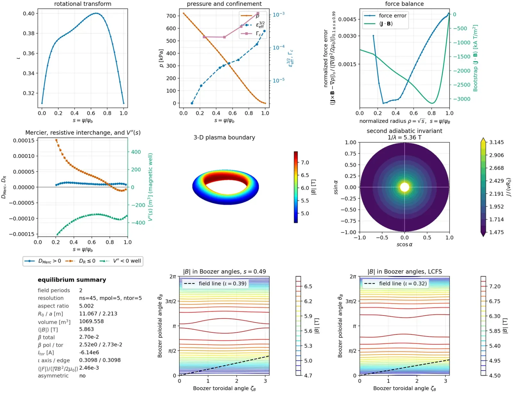
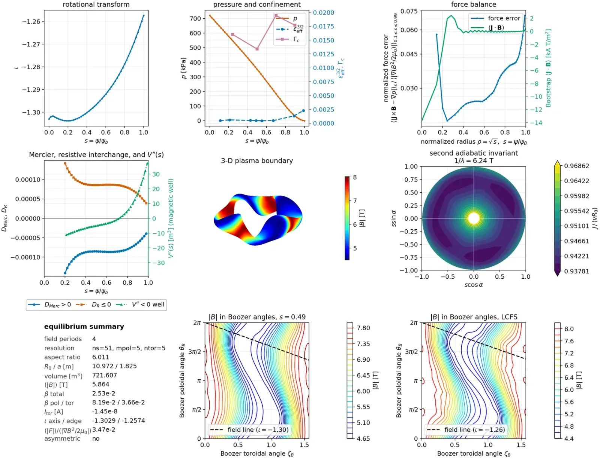

## Differentiate and optimize

Compute a boundary/profile derivative without differentiating through every forward iteration:

```python
import jax
from vmex.core import implicit

params = implicit.params_from_input(inp)
gradient = jax.grad(lambda p: implicit.run(inp, p).aspect)(params)
```

For a simple boundary optimization, supply objectives and let SciPy choose the
steps. Each tuple is `(function, target, cost_weight)`:

```python
from scipy.optimize import least_squares
from vmex import optimize as opt

problem = opt.VmecProblem.from_tuples(
    inp, [(opt.aspect_ratio, 4.0, 1.0)], max_mode=1, use_ess=True)
fit = least_squares(
    problem.residual, problem.x0, jac=problem.residual_jac,
    x_scale=problem.scales, max_nfev=20)
problem.input_from_x(fit.x).to_indata("input.optimized")
equilibrium = problem.equilibrium_from_x(fit.x)
vj.write_wout("wout_optimized.nc", equilibrium.wout)
```

`problem.value_and_grad` supplies scalar objectives to BFGS/L-BFGS-B, `problem.jax_value_and_grad`
to JAX optimizers, and `problem.evaluate(x)` reports solve effort and derivative status. The
[gradient tutorial](https://vmex.readthedocs.io/en/latest/tutorials/first-gradient.html) and
[optimization guide](https://vmex.readthedocs.io/en/latest/howto/optimize-a-boundary.html) cover
convergence checks, constraints, scaling and finite-difference verification.

## Ballooning stability

The infinite-n ideal ballooning mode ([Dewar and Glasser 1983](https://doi.org/10.1063/1.864113),
[Gaur et al. 2023](https://arxiv.org/abs/2302.07673)) is the eigenproblem along a field line,

$$\frac{d}{d\eta}\Big(g\,\frac{dX}{d\eta}\Big) + c\,X = \lambda\,f\,X,\qquad X(\pm\eta_b)=0,$$

with line bending `g`, pressure and curvature drive `c` and inertia `f > 0`. A line is unstable
when its largest eigenvalue `λ = (γ a_N/v_A)²` is positive. VMEX discretizes it with finite
differences, takes the largest eigenvalue of the resulting tridiagonal matrix with a Richardson
step in the grid spacing, and differentiates it with Hellmann–Feynman, `dλ = vᵀ dA v`, so
`ballooning_residual` works as an implicit least-squares target.

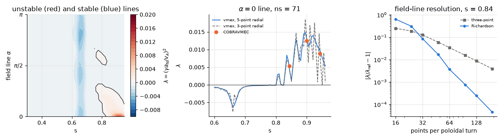

Finite-beta QA seed (`input.nfp2_QA_finite_beta`, ns = 71)
([script](docs/_static/figures/sources/make_ballooning_figure.py), about 3 minutes on a laptop):

- **COBRAVMEC parity:** with COBRA's three-point radial stencil, four lines agree within 1.7%
  (`tests/test_stability.py`). The default five-point stencil reads 2–6% higher and is closer to
  the converged value.
- **Field-line grid:** the Richardson step from 128 points per poloidal turn is within 0.05% of
  the converged eigenvalue; the plain three-point result is 1% low.
- **Radial grid:** the maximum over 16 field lines and 9 ballooning parameters agrees within 5%
  between ns = 41 and 101, while `λ(s)` on one line is rough and changes sign twice between
  s = 0.80 and 0.83.

Details and the optimization recipe: [stability theory](docs/explanation/confinement.rst) and
[objectives](docs/reference/objectives.rst).

## What you can build

Every figure below is regenerated by the script named beside it, from decks in this repository.

### Quasisymmetric and quasi-isodynamic boundaries

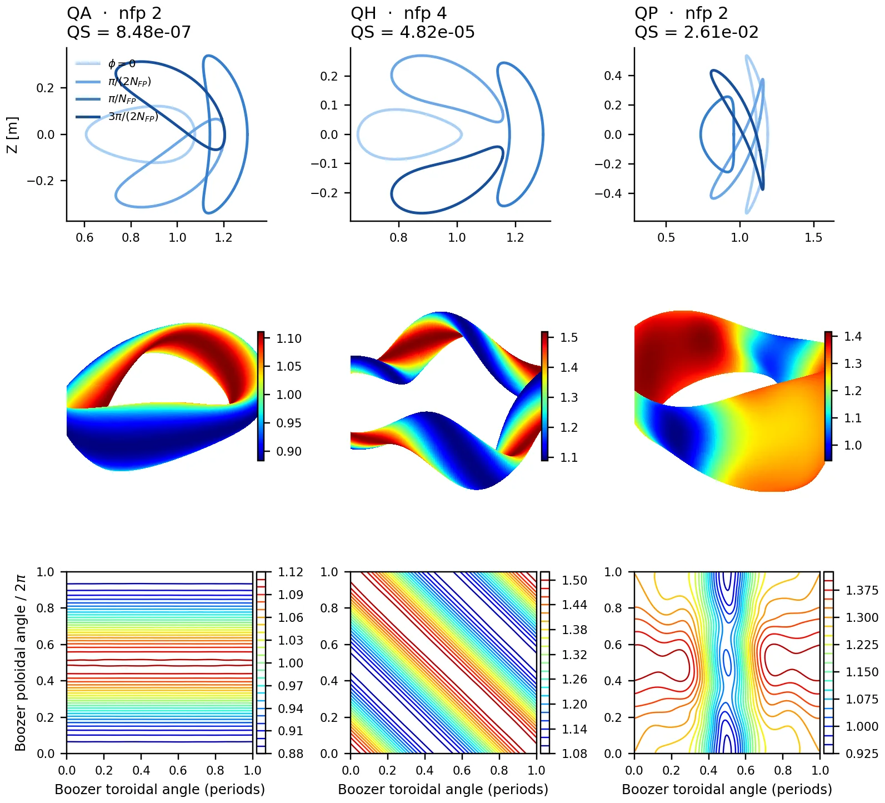

Boundary optimization for quasi-axisymmetry, quasi-helical symmetry and quasi-poloidal symmetry, each at its own
field-period count, from `examples/optimization/QA_optimization.py` and its QH and QP siblings.
`python examples/plot_optimized_families.py` draws the panel.

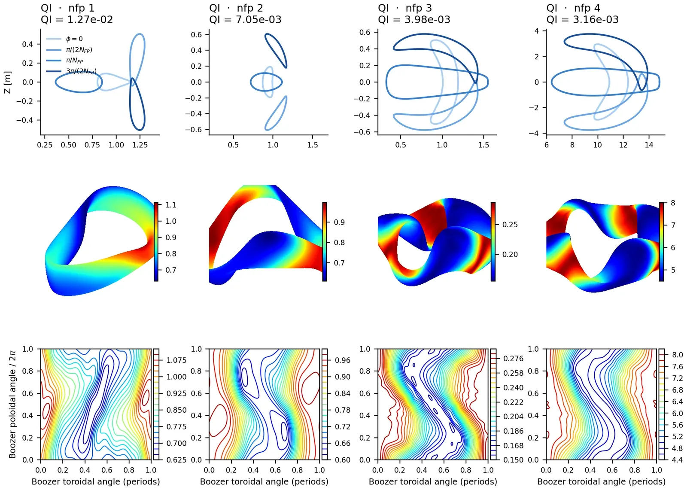

Quasi-isodynamic designs at four field-period counts: the `|B|` contours close poloidally as `nfp`
rises. The QI scripts in `examples/optimization/` cover vacuum, finite-beta, bootstrap-consistent and
maximum-`J` variants, with scalar-adjoint, SciPy, JAXopt and Optax drivers.

### Free boundary with coils

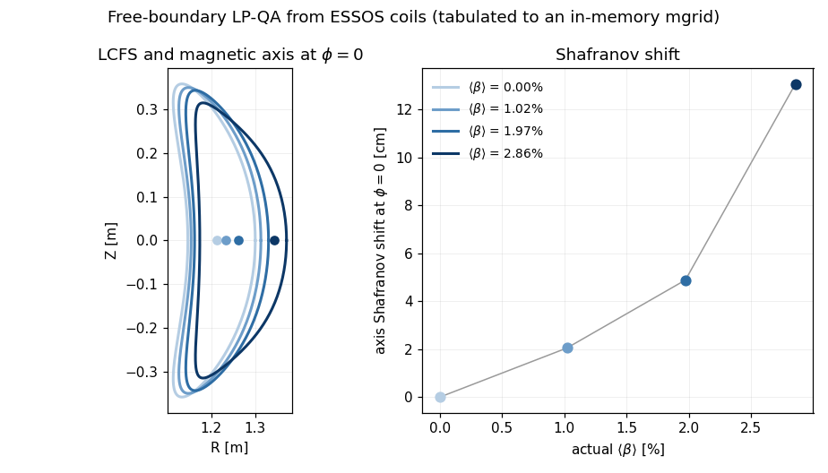

NESTOR free boundary driven by ESSOS coils (or an MGRID table), ramping beta and tracking the
Shafranov shift: `python examples/free_boundary_essos_coils.py`. The exterior field is described
[below](#fields-coils-and-free-boundary).

### Single-stage plasma and coil design

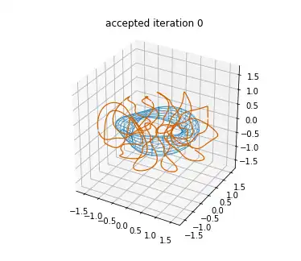
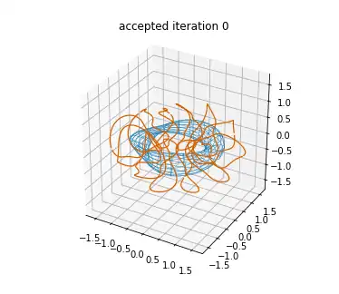

Accepted iterates of `single_stage_optimization.py` (left, fixed boundary in vacuum) and
`single_stage_free_boundary_optimization_finite_beta.py` (right, free boundary at 0.5% beta).

`examples/optimization/single_stage_optimization.py` adjusts the plasma boundary and the coils
against one weighted objective, solving the equilibrium implicitly at every step;
`single_stage_free_boundary_optimization.py` couples them through a true free-boundary solve. Both
print final plasma and coil metrics. Each free-boundary trial is Newton-refined onto the root of the
coupled plasma-vacuum residual, where its gradient is exact.

## Open mirrors and stellarator-mirror hybrids

VMEX solves the same scalar-pressure force balance, `J x B = grad p` on nested flux surfaces, by
minimizing the MHD energy. Only the coordinates change.

| | Tokamak or stellarator | Open mirror |
|---|---|---|
| Coordinates | `s` and two periodic angles | `(s, theta, xi)` |
| Radial / axial | `s` in `[0, 1]` | `s` in `[0, 1]` and `xi` in `[-1, 1]` between two end cuts |
| Periodic angle | two | one (`theta`, Fourier modes) |
| Axial basis | toroidal Fourier modes | clamped cubic B-splines in `xi` |

- The end cuts `xi = ±1` are boundary conditions: their nested surfaces are prescribed and flux
  passes through them.
- The free boundary couples the side surface `s = 1` to an open exterior vacuum problem.
- The field is divergence-free by construction, `sqrt(g) B^theta = I'(s) - d(lambda)/d(xi)`,
  `sqrt(g) B^xi = Psi'(s) + d(lambda)/d(theta)`, `B^s = 0`. This is the Clebsch form
  `B = grad Psi x grad alpha` with `alpha = theta + lambda/Psi' - (I'/Psi') xi`
  ([mirror geometry](https://vmex.readthedocs.io/en/latest/explanation/mirror-geometry.html)).
- A stellarator-mirror hybrid closes two straight mirror legs with curved stellarator returns and
  uses a periodic spline along its length.

```console
vmex examples/data/input.mirror_two_coil_free_boundary --plot   # a &MIRROR deck, writes mout_*.nc
```

```python
from vmex.mirror import MirrorInput, solve_mirror
solution = solve_mirror(MirrorInput.from_file("examples/data/input.mirror_two_coil_free_boundary"))
```

You give the boundary (or the coils), flux and pressure; `solve_mirror` builds the spline grid,
initial state and exterior grid.

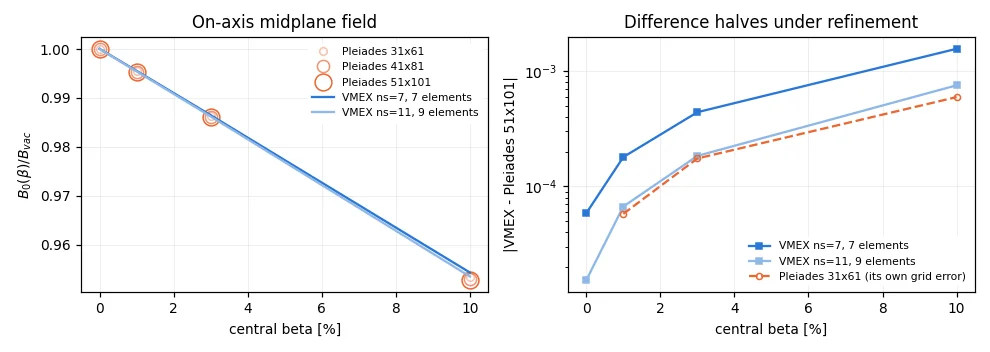

Benchmarked against the independent Pleiades Green-function code on the two-coil mirror from vacuum to
10% beta: the on-axis field agrees to 7.5e-4 or better on the finer VMEX grid, the difference halves
under refinement, and what remains is the size of Pleiades' own grid error
(`docs/_static/figures/sources/make_mirror_pleiades_figure.py`). More mirror and hybrid examples, and
which lanes are validated: [mirror guide](https://vmex.readthedocs.io/en/latest/howto/mirror-machines.html).

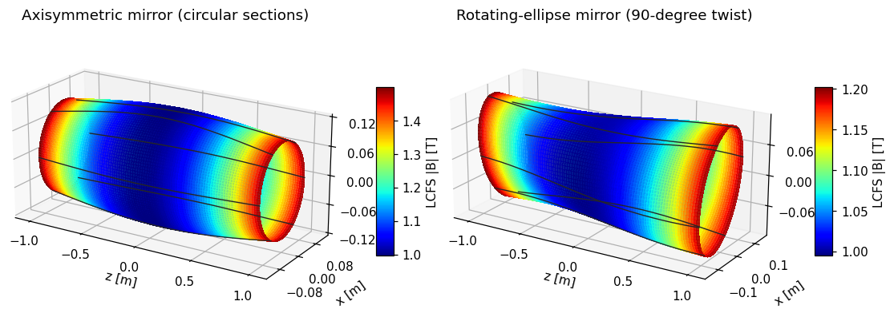
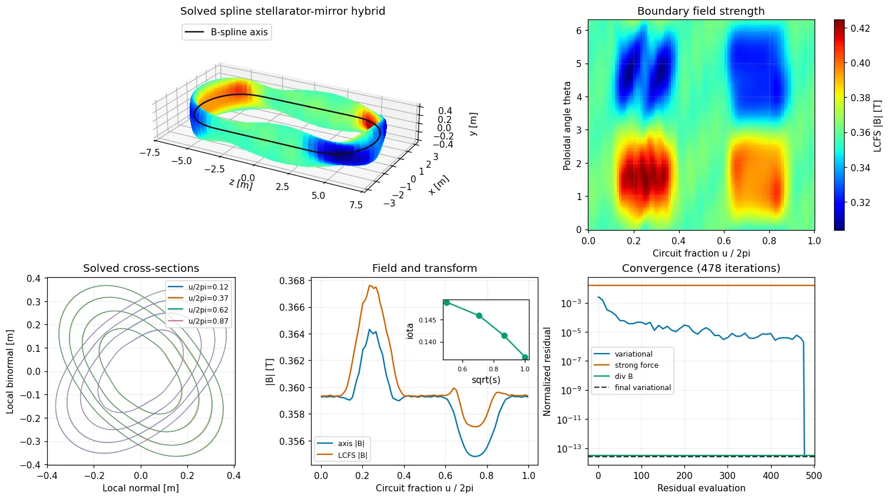

## Fields, coils and free boundary

The equilibrium exposes Cartesian `B()` and its first three derivatives, with VJPs, anywhere inside
the plasma (`set_points_xyz`, `set_points_flux`); it reads the current 10 to 70 times more
accurately than the WOUT file. Outside, `vj.VmecExtender.from_file("wout_my_case.nc",
external_field=coils.B)` adds the plasma's virtual-casing field to the coils, accurate to about 1e-12
down to 0.01 minor radii. Coil and MGRID fields enter free-boundary solves as `MgridField`
(trilinear or tricubic).

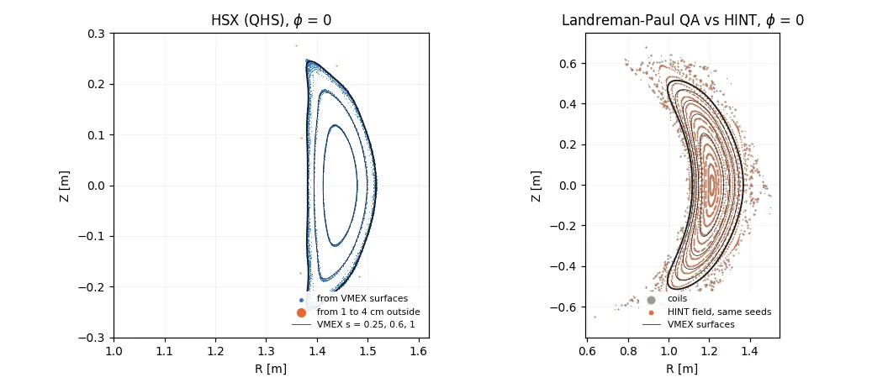

The Landreman-Paul QA held by its coils as a free boundary at 1.0% beta, and the field lines of
the extended field (coils plus the plasma's virtual-casing field) launched outside it. Without net
current (left) closed surfaces continue 3.1 cm past the LCFS, then the lines open. A 4 kA toroidal
current (middle, and unrolled on the right) lifts the edge iota to 0.514, so iota = 1/2 falls just
outside the plasma: an island chain about 0.9 cm wide opens from the LCFS, closed surfaces
surround it to 2.9 cm, and the lines open beyond. The figure is built by VMEX from `examples/data` alone
(`docs/_static/figures/sources/make_extender_islands_figure.py`). The vacuum case and the method
are in the [fields and coils guide](https://vmex.readthedocs.io/en/latest/howto/use-essos-fields-and-coils.html).

### Opt-in solver options

Off by default, so VMEC2000 iteration parity is kept:

- Newton anchoring (`vmex.solve_free_boundary_newton`) puts a converged free-boundary state on the
  exact root of the coupled plasma-vacuum residual
  ([how-to](https://vmex.readthedocs.io/en/latest/howto/free-boundary-newton.html)).
- Position control (`LPOSITION_CONTROL = T` or `position_control=vj.PositionControl(target=...)`) is a
  PID law on the axis radius that sets a uniform vertical field to hold a current-carrying
  free-boundary plasma in place. Example: `python examples/free_boundary_position_control.py`
  ([explanation](https://vmex.readthedocs.io/en/latest/explanation/position-control.html)).
- `vmex.relax_free_boundary_constraint` continues a converged free-boundary state with a weak
  spectral constraint, removing the bias that makes the LCFS differ from the coil field by 1e-3 to
  1e-2 in `|B|`. It helps on vacuum and well-resolved decks (`|B|` error 3-10x lower, force error
  4-15x lower); check it against the coil field at low resolution, where it can be worse.
  `result = vmex.solve_free_boundary(inp, external_field=field)`, then
  `relaxed = vmex.relax_free_boundary_constraint(inp, result, external_field=field)`.
  Example: `python examples/free_boundary_relax_constraint.py`
  ([how-to](https://vmex.readthedocs.io/en/latest/howto/free-boundary.html)).
- `solve_multigrid(inp, lambda_m0_floor=1e-3)` adds a radial preconditioner for the m = 0 lambda
  force of fixed-boundary stellarators converged to a very small `ftol`; iterations fall by up to 9%
  ([iteration](https://vmex.readthedocs.io/en/latest/explanation/iteration.html)).

## Tracing from the axis to the wall

Orbits do not end at the LCFS. With ESSOS (`vmex[coils]`), guiding centres move in VMEC coordinates
inside, cross the LCFS at a root-found time, and continue in the field outside (coils or mgrid plus the
plasma's virtual-casing field, tabulated once) until they strike a wall, come back in, or reach the end
time. Below, 3 keV protons in the vacuum Landreman-Paul QA equilibrium, with a wall 3 cm outside the LCFS
(`examples/vmex_essos_tracing_to_wall.py`).

```python
setup = vj.essos_tracing_fields(wout, coils, wall=0.03)     # field, exterior_field, wall
trace = essos.dynamics.Tracing(**setup, model="GuidingCenterAdaptative", particles=particles, maxtime=4e-5)
trace.wall_hits, trace.wall_positions, trace.returns
```

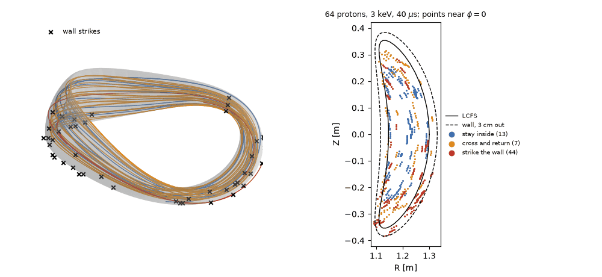

The equations, the exterior-field options, the interpolation error and the outputs are in the
[wall-tracing guide](https://vmex.readthedocs.io/en/latest/howto/trace-to-the-wall.html).

## Alpha-particle losses

`--trace` (needs `vmex[coils]`) scales the same way in memory and traces 500 fusion alphas for
10 ms in Boozer coordinates (under a minute on 10 CPU cores; a GPU is faster for large ensembles). It writes the loss fraction and a figure set:
loss against time, loss maps on the boundary, and pitch and loss-time distributions. Production runs set
`--trace-particles N` and `--trace-tmax T`; cost grows as `N x T`. `--trace-birth volume` samples the D-T
birth profile, and `--collisional` adds slowing down and pitch-angle scattering
([guide](docs/howto/trace-alpha-particles.md)).

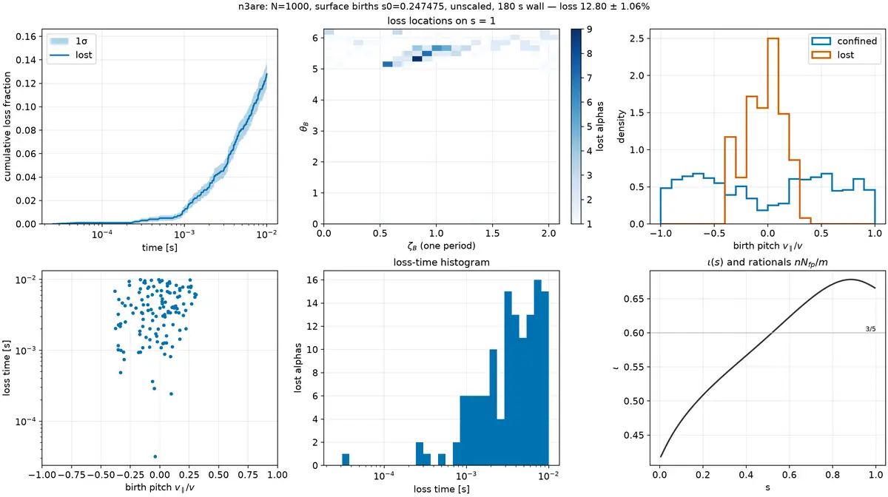

`--trace` is compared with SIMPLE and SIMSOPT on matched alphas, and its mode cut and timestep are
checked on twenty equilibria ([guide](docs/howto/trace-alpha-particles.md#convergence-of-the-defaults)).

The ESSOS tracer behind `--trace` (here with ESSOS's fixed-step Dopri8 defaults; `--trace` controls
the step adaptively) against SIMPLE, FIRM3D, SIMSOPT and DESC on 256 matched 3.5 MeV alphas from
`s = 0.5` over 10 ms (DESC: the first 32), on 8 Apple M4 cores
([record](benchmarks/essos_cross_code.json), from uwplasma/ESSOS#162):

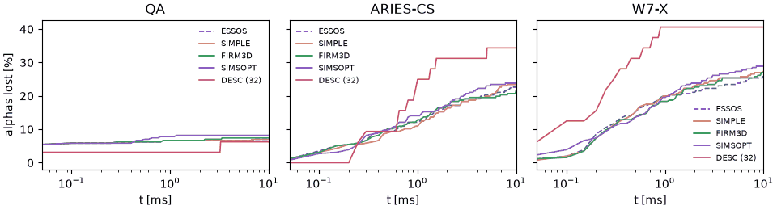

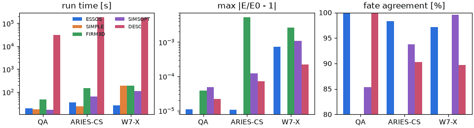

## Neoclassical transport

A stellarator's confinement is set as much by neoclassical transport as by its shape. Collisions and drifts in the 3-D
field fix the radial electric field, the bootstrap current that changes the rotational transform, and a 1/ν
loss channel that tokamaks do not have. `vmex --neoclassical` (needs `vmex[neoclassical]`) runs the drift-kinetic solver
[DKX](https://github.com/uwplasma/DKX) on a solved equilibrium and returns all three:
- the monoenergetic coefficients `D11*`, `D31*`, `D33*` against collisionality;
- the ambipolar root `E_r(r)`;
- the particle and heat fluxes of each species at that root;
- the bootstrap `<j·B>`, set against VMEX's Redl formula on the same profiles and the equilibrium's own current.

The `--nc-profiles` file holds `n_e`, `T_e` and `T_i` as polynomials in `s`
([guide](docs/howto/neoclassical-transport.md)). On the bundled QA, β = 2.5 % deck:

```console
vmex wout_LandremanPaul2021_QA_beta2p5_bootstrap.nc --neoclassical \
     --nc-profiles examples/data/kinetic_profiles.LandremanPaul2021_QA_beta2p5_bootstrap.json
```

It writes `*_neoclassical.png` and `*_neoclassical.h5`. The figure below is drawn from that `.h5`
([script](docs/_static/figures/sources/make_neoclassical_figure.py)). Runtime: 6.5 min on 4 CPU cores,
compilation included.

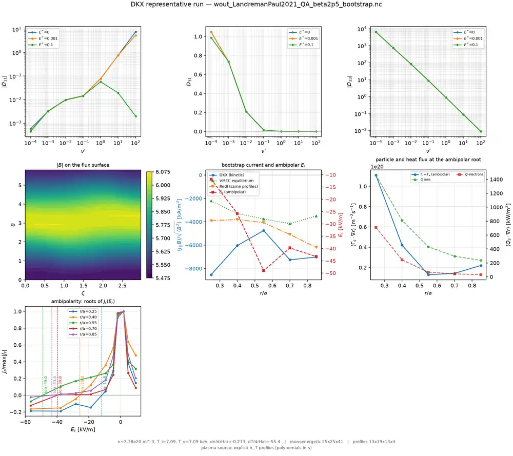

## Turbulence

`--turbulence` (needs `vmex[turbulence]`, GKX >= 2.6.0) samples the flux tube at `s = 0.5`, `α = 0` and runs
[GKX](https://github.com/uwplasma/GKX) on it: a linear `k_y` scan, the eigenfunction at the fastest-growing `k_y`,
and a short nonlinear ITG simulation (`a/L_T = 3`, `a/L_n = 1`, adiabatic electrons). The terminal shows each
stage with an estimate of the time left. The run writes the saturated heat flux with its standard error, a
summary figure, the field-line geometry and the flux traces. `--turbulence-s`, `-alpha`, `-ky`, `-grid`,
`-moments`, `-tmax`, `-gradients` and `--turbulence-kinetic-electrons` change the run
([guide](docs/howto/turbulence.md)). The defaults are a few-minute survey and are not converged.

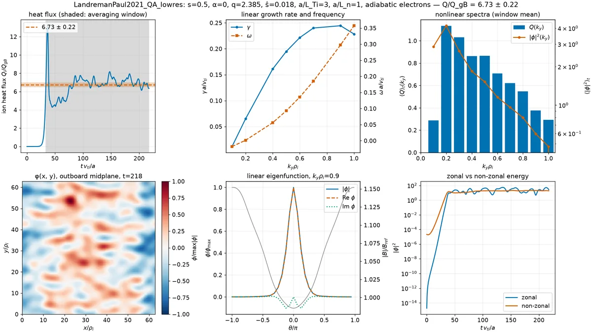

## How VMEX works

1. **Energy principle.** VMEX finds a stationary point of `W = ∫ (B²/2μ₀ + p/(γ−1)) dV` over
   nested flux surfaces, where `J × B = ∇p`. As in VMEC, the unknowns are the surface shapes `R`, `Z`
   and the angle function `λ`: Fourier series in both angles, finite differences in radius.
2. **Spectral force iteration.** Each iteration evaluates the Fourier-projected forces and takes a
   damped second-order Richardson step with VMEC2000's time-step control and restarts, in its
   order. A radial tridiagonal preconditioner per Fourier mode makes the step effective (a 2-D block
   preconditioner is opt-in), and `NS_ARRAY` runs a coarse-to-fine radial multigrid ladder. The
   solve has converged when `FSQR`, `FSQZ` and `FSQL` fall below `FTOL`.
3. **Free boundary.** NESTOR solves the exterior Neumann problem for the vacuum potential with
   Merkel's Green's-function method, driven by an MGRID table or a coil field; pressure balance
   across the boundary moves the plasma surface.
4. **Implicit derivatives.** At a root `F(x, p) = 0` of the force residual, `dx/dp = −(∂F/∂x)⁻¹ ∂F/∂p`.
   A scalar objective needs one adjoint linear solve for all parameters, and least-squares
   Jacobians factor the block-tridiagonal radial operator once. The forward iterations are not
   recorded, so memory does not grow with their number. The derivative assumes that the state is a
   root (on a fixed boundary VMEX first Newton-refines it to `refine_tol = 1e-10`), that `∂F/∂x` is
   invertible there, and that perturbed solves stay on the same branch. It is the derivative of the
   discrete equations, not of the continuum problem.
5. **Virtual casing.** `VmecExtender` adds the plasma currents' field, a surface integral over
   the boundary field, to the coil field outside the plasma; its error grows near the surface.

The [explanation pages](https://vmex.readthedocs.io/en/latest/explanation/index.html) derive each step.

## Force-balance polishing

A small VMEC `FSQR/FSQZ/FSQL` means the discrete solve converged, not that the continuous force
`J × B − ∇p` is small. Polishing (`polish=True` or `--polish`) re-solves that force on a quintic
spline and, for the axisymmetric case, certifies it with an independent oracle. To request it
from a deck, add one comment line at the top of the INDATA file (VMEC2000 ignores it):

```fortran
! VMEX: POLISH_FORCE_BALANCE = .TRUE.
```

**Tokamak** (certified; `NCURR = 0`, `GAMMA = 0`, `LASYM = F`). `python examples/force_balance_polishing.py`
takes about a minute.

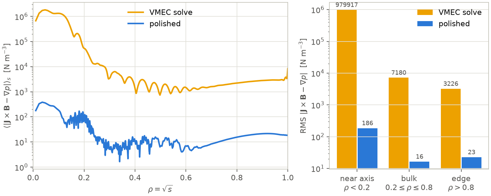

- RMS force over the volume falls from 2.0e5 to 42 N m⁻³, near the axis from 9.8e5 to 190, at the
  edge from 3.2e3 to 23.
- Projected stationarity is 1e-10, and the written WOUT reproduces the native certificate.
- `eps_F` is bounded above by 2 by construction and saturates in vacuum; read the dimensional
  metrics with it.

**Stellarator** (finite-beta QA, prescribed toroidal current, no certificate yet).
`python examples/prescribed_current_polishing.py` takes 46 s on a laptop (9 s for the solve, 16 s
for the polish).

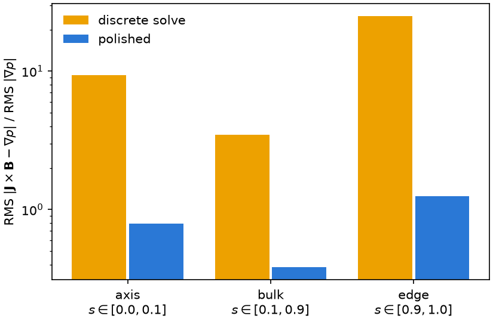

- The RMS force relative to the pressure gradient falls 12× near the axis, 9× in the bulk and
  20× at the edge on a held-out grid.
- L-BFGS stops at |grad| = 4.6e-4 after 150 iterations: a forward result, not a converged one.

See the [polishing reference](https://vmex.readthedocs.io/en/latest/explanation/high-order-force-balance.html)
and the [validation record](docs/explanation/validation.md).

## Comparison with MRX

`python examples/vmex_mrx_comparison.py` (about 4 minutes, `pip install mrx`) relaxes the 2.5 %
beta QA deck with [MRX](https://github.com/ToBlick/mrx), which does not assume nested surfaces,
starting from the VMEX ns = 65 field.

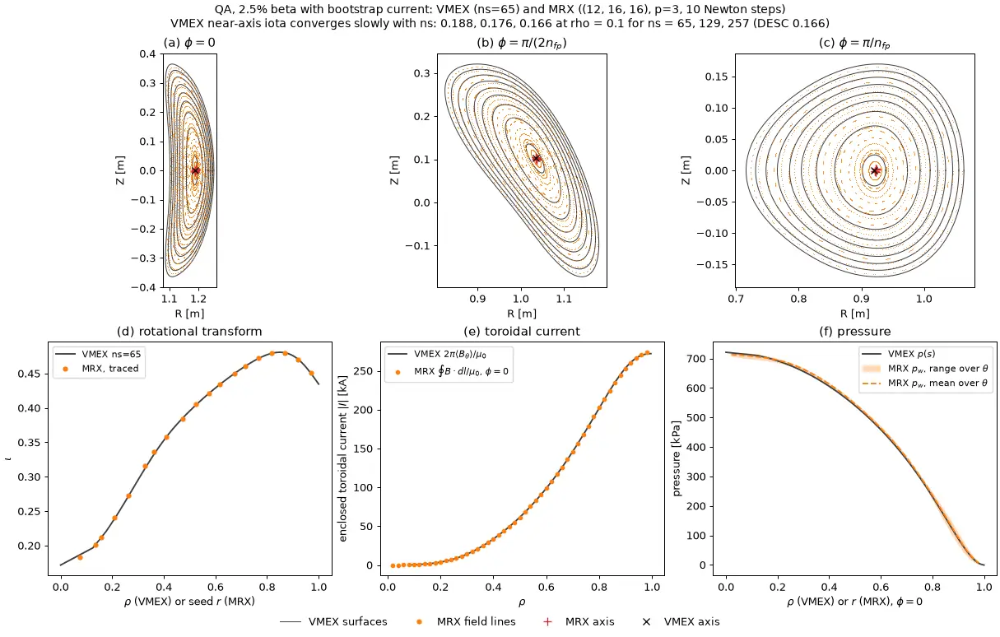

- Traced iota, enclosed current and pressure agree with VMEX.
- Near the axis VMEX iota still moves with ns: 0.188, 0.176, 0.166 at ρ = 0.1 for ns = 65, 129,
  257, against 0.166 from DESC.

## Validation and speed

- **VMEC2000 parity.** CI solves six decks against stored VMEC2000 output and requires `wb` within
  `1e-7` relative, `iota` and `R`, `Z` harmonics on three surfaces within `1e-5`, and iteration
  counts within ±25%. On six decks never run before (ITER, W7-X, HSX, ARIES-CS, ESTELL,
  Nührenberg–Zille), the worst relative difference from VMEC2000 was `2.5e-10`, and the iteration
  counts were identical on five and one apart on the sixth
  ([performance records](docs/reference/performance.rst), VMEX 0.8.1).
- **Speed.** On those decks (Apple M4 CPU, one run each) VMEX took 0.50–1.34 times the VMEC2000
  wall time with a warm compilation cache and 0.60–3.13 times with it cleared; the difference is
  mostly XLA compilation, which a repeated solve in one process skips. In the older
  [ns = 201 table](https://vmex.readthedocs.io/en/latest/reference/performance.html) (VMEX 0.3.0)
  VMEC++ was faster than VMEX on the largest 3-D decks it completed. On two RTX A4000 GPUs no
  shipped deck or problem size ran faster than on the CPU.
- **Derivatives.** CI compares adjoint gradients with central finite differences: four Solov'ev
  gradients to `1e-6` relative and a 3-D `li383` boundary gradient to `2e-4`. One warm
  value-plus-Jacobian evaluation of a 48-parameter QA problem took 16.6 s on an Apple M4
  ([record](benchmarks/qa_optimization_startup_least_squares_m4.json), VMEX 0.7.0).
- **Validation record.** The [validation record](docs/explanation/validation.md) lists every
  gate, tolerance and benchmark record, with the measured accuracy of each lane.

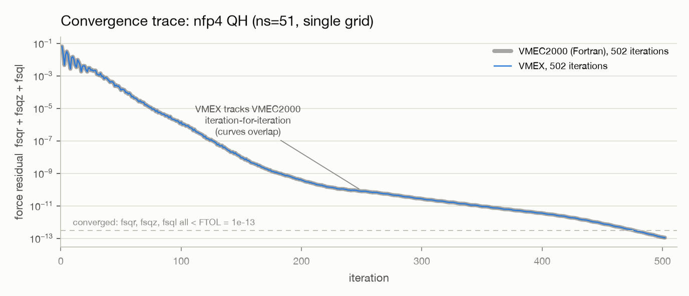

The NFP=4 QH deck at ns = 51 in all three codes, from a trace recorded in July 2026
(`python docs/_static/figures/sources/make_readme_figures.py --only convergence`).

### Against exact equilibria

Resolution studies and code comparisons cannot see an error that every resolution or every
VMEC-type code shares. [Landreman (2026)](https://arxiv.org/abs/2609.26742) found closed-form 3-D
equilibria with finite pressure and nested surfaces, and
[Issan et al. (2026)](https://arxiv.org/abs/2610.07304) broke their stellarator symmetry with one
parameter `tau`. [vmex-benchmark-analytical](https://github.com/rogeriojorge/vmex-benchmark-analytical)
scores VMEX, VMEC2000 and DESC against them.

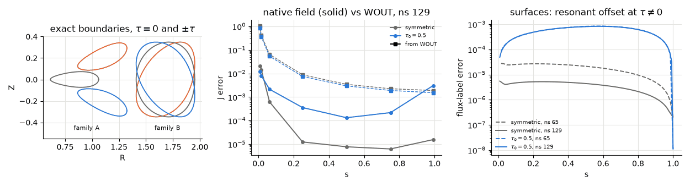

- The exact solutions exposed two VMEX defects that resolution studies missed, both fixed: the
  field at the axis (#452) and refinement before derivatives (#453).
- At mid-radius the continuous field gives the current 23–450 times more accurately than the
  WOUT file; B is right to 1e-5.
- Without stellarator symmetry the full basis adds no error: `tau = 0` reproduces the symmetric
  solution to every digit, and mirror pairs agree to 1e-9.
- With `tau != 0` the `iota = 2` family is degenerate: VMEX converges to a neighbouring
  equilibrium that differs by 8e-4 at every resolution. See the
  [validation record](docs/explanation/validation.md#exact-equilibria).

## Performance and parallel execution

JAX compiles each solve once per array structure and reuses the executable for matching shapes, so
measure first-call, cache-reload and warm costs separately, including refinement and gradients for
optimization. CPU and GPU performance depend on resolution and workload; the dated measurements are
in the [performance reference](https://vmex.readthedocs.io/en/latest/reference/performance.html)
and the [benchmark records](benchmarks/).

`vj.parallel.solve_ensemble(inputs, workers=None)` solves independent cases concurrently and returns
results in input order, each identical to solving that input alone; `workers=1` is the serial
baseline. Set worker and device budgets with the
[ensemble guide](https://vmex.readthedocs.io/en/latest/howto/parallel-ensembles.html). Multi-device
kernel and derivative tests do not yet establish a scalable distributed nonlinear equilibrium solve.

## Running the examples

The examples live in the repository, not in the wheel. From a clone:

```console
git clone --filter=blob:none https://github.com/uwplasma/vmex
cd vmex
pip install -e ".[all]"
vmex examples/data/input.circular_tokamak --plot
python examples/take_fixed_boundary_gradients.py
```

| Application | Runnable starting point | Needs |
|---|---|---|
| Tokamak or stellarator equilibrium | `vmex examples/data/input.circular_tokamak --plot`; other decks in [examples/data](examples/data/) | core |
| QA, QH, QP or QI boundary design | [examples/optimization](examples/optimization/), including bootstrap, ballooning, Mercier and maximum-`J` variants | core |
| JAXopt and Optax drivers | `QI_optimization_jaxopt.py`, `QI_optimization_optax.py` | `vmex[optimizers]` |
| Asymmetric boundary design | [stellarator_asymmetry](examples/optimization/stellarator_asymmetry/) vacuum and finite-beta scripts | core |
| Single-stage plasma and coils | `single_stage_optimization.py`, `single_stage_free_boundary_optimization.py` | `vmex[coils]` |
| Fields and spatial derivatives | `python examples/vmex_get_B_gradB.py` | core |
| Exterior field from coils and plasma | `python examples/vmex_get_B_outside_plasma.py` | `vmex[coils,freeb]` |
| ESSOS coils and a free-boundary beta scan | `python examples/free_boundary_essos_coils.py` | `vmex[coils]` |
| Free boundary from an MGRID table | `python examples/free_boundary_mgrid.py` | core; first `python tools/fetch_assets.py --bundle reference-nc` |
| Field lines outside a finite-beta plasma | `python examples/vmex_fieldline_tracing_finite_beta.py` | `vmex[coils,freeb]` |
| Effective ripple | `python examples/epsilon_effective.py` | `vmex[neoclassical]` |
| Independent-case ensembles | `python examples/parallel_ensemble_scan.py` | core |
| Open mirrors | `mirror/mirror_fixed_boundary_nonaxisymmetric.py`, `mirror/mirror_free_boundary_beta_scan.py` | core; the beta scan needs `vmex[coils]` |
| Research force-balance polishing | `python examples/force_balance_polishing.py` | core |

The optimization scripts expose resolutions, objective weights and iteration budgets near the top.
Inspect those settings before a research run; advanced coil examples need the optional dependencies
and versions in the [ESSOS guide](https://vmex.readthedocs.io/en/latest/howto/use-essos-fields-and-coils.html).
## Documentation, development and citation

Start with [your first equilibrium](https://vmex.readthedocs.io/en/latest/tutorials/first-equilibrium.html)
and [your first optimization](https://vmex.readthedocs.io/en/latest/tutorials/first-optimization.html),
then the [API](https://vmex.readthedocs.io/en/latest/reference/api/basic.html),
[VMEC compatibility](https://vmex.readthedocs.io/en/latest/reference/vmec2000-compatibility.html) and
[troubleshooting](https://vmex.readthedocs.io/en/latest/howto/troubleshoot.html) pages. For development,
`pip install -e ".[dev]"` and `python tools/preflight.py --static`. Report issues with the input deck
and `vmex --doctor` output. See [contributing](CONTRIBUTING.md), [citation](CITATION.cff),
[license](LICENSE) and the [archived plan](https://github.com/uwplasma/vmex/blob/35a5158f47bfb9d17bd4092ff518facda54cb0af/plan.md).
