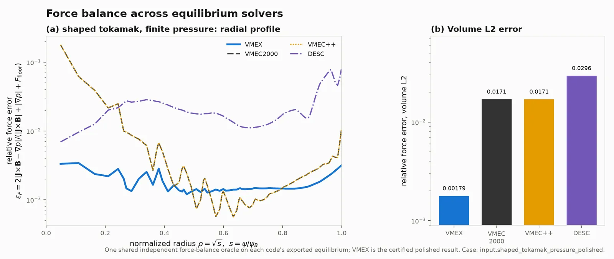

# What is validated, and against what

This page is the map of VMEX's evidence. For every class of claim the code
makes, it names the gate that enforces it, the tolerance in that gate, and
the artifact behind the number. It also names what is *not* validated, which
is the part a reader checking a solver actually needs.

Two rules run through the whole page. Where a number appears here it is a
tolerance some test asserts or a value some committed artifact records — not
a remembered result. And where the honest answer is "this is a record, not a
gate", the page says so instead of implying coverage.

## The evidence hierarchy

VMEX uses five complementary types of evidence. Each addresses a different
question; none alone establishes accuracy for every supported model.

1. **Analytic limits.** The answer is known in closed form, so agreement is
   evidence about the implementation within that analytic model. The true
   Solov'ev projection and mirror paraxial/vacuum identities are here.
2. **An independent oracle.** A second implementation of the physics, written
   against a different discretization, scores the same equilibrium. VMEX's
   continuum force-balance oracle is here. Independence must be checked for
   the specific derivative, representation and normalization under test;
   analytic and native cross-code tests provide complementary checks.
3. **Reference-code parity.** VMEC2000 is the reference implementation; VMEX
   reproduces its trajectory and its output file. This is the largest tier by
   test count, and its weakness is structural — it can only show that VMEX
   agrees with VMEC2000, never that either is right.
4. **Internal consistency.** Adjoint against finite difference, forward
   against transpose, CPU against accelerator, one lane against another.
   These catch implementation error, not modelling error.
5. **Committed records without a gate.** Measurements that are stored and
   hashed but that no test asserts on. They are provenance, not validation,
   and this page marks them as such.

`tests/manifest.json` classifies every test by the oracle it checks against,
so the balance of tiers is countable rather than asserted:

```bash
python -c "import json,collections; print(collections.Counter(
    r[6] for r in json.load(open('tests/manifest.json'))['records']))"
```

On VMEX 0.11.0 that reads `analytic` 53, `vmec2000` 18, `fd` 17,
`none` 17, `external` 10, `golden` 7. Run it rather than trusting the
snapshot; it moves with every test added.

## VMEC2000 parity, tier by tier

Parity is checked at four different resolutions of detail. Each tier is a
separate suite with its own gate.

### Trajectory: the same iterations, not just the same answer

`tests/test_parity_breadth.py` runs six decks — `DSHAPE`,
`circular_tokamak`, `li383_low_res`, `LandremanPaul2021_QA_lowres`,
`nfp4_QH_warm_start`, `up_down_asymmetric_tokamak` — against stored VMEC2000
goldens and asserts:

| quantity | gate |
|---|---|
| convergence | `fsqr`, `fsqz`, `fsql` all at or below the deck `ftol` |
| iteration count | within `[0.75 g, ceil(1.25 g)]` of the golden `g` |
| `wb` | relative difference below `1e-7` |
| mode tables `xm`, `xn` | bit-exact |
| `iotaf` | `rtol=1e-5` |
| `rmnc`, `zmns` (and the LASYM partners) | `rtol=1e-5` on three surfaces: axis-adjacent, mid, edge |

The iteration window is the one to read carefully. Iteration counts are the
parity quantity that legitimately moves with the floating-point path, so the
enforced gate is `+-25%`, not equality — even though the counts observed on
the recorded runs match exactly on most decks. Anywhere this documentation
prints an iteration table, it is reporting what a run did, not what CI
requires.

Two decks carry a looser harmonic `atol` because their goldens are
NITER-capped rather than converged: `5e-6` for `LandremanPaul2021_QA_lowres`
and `2e-5` for `up_down_asymmetric_tokamak`. For the latter, a fully
converged VMEC2000 rerun agrees with VMEX's converged core to `7.3e-7` on
every checked harmonic. Two decks are deliberately absent:
`NuhrenbergZille_1988_QHS` (over the 120 s budget, no golden in the bundle)
and `cth_like_free_bdy_lasym_small` (free boundary).

These tests need no VMEC2000 binary — they read a stored, sha256-verified
golden bundle, resolved from `VMEX_GOLDEN_DIR`, then `~/vmex_notes/golden`,
then a verified download. Tests that do need a live binary are marked
`vmec2000_live` and run only under `--run-vmec2000`.

```{figure} /_static/figures/readme_convergence.webp
:alt: force-residual traces for VMEX, VMEC2000 and VMEC++ on the NFP=4 QH case
:align: center
:width: 90%

Parity along the whole trajectory, not only at the endpoint: total force
residual per iteration for the bundled NFP=4 QH case at `ns=51` through all
three codes. Regenerate with
`python benchmarks/make_readme_figures.py --only convergence`.
```

### Scalars: a cheap gate that needs no golden bundle

`tests/golden_digests.json` stores ten scalars per case (`wb`, `wp`,
`aspect`, `volume_p`, `betatotal`, `b0`, `betapol`, `betator`, `rmax_surf`,
`rmin_surf`), the `iotaf` and `presf` endpoints, and two boundary geometry
checksums. `tests/test_golden_digests.py` compares them at `rtol` `2e-4` for
`wb` and `aspect`, `5e-4` for the volume, field, extent and geometry
checksums, `3e-3` for the `iotaf` endpoints, and `3e-3` by default, all with
`atol=1e-8` so quantities passing through zero do not produce false
failures. Two cases run on every pull request; five more run under
`RUN_FULL=1`. Regenerate with `python tools/make_golden_digests.py`.

### The output file: every variable, by class

`tests/test_wout_golden.py` compares a written `wout` against the golden
one variable at a time on `solovev`, `cth_like_fixed_bdy`, `li383_low_res`
and `up_down_asymmetric_tokamak`. It asserts structure first (same
variables, dimensions and dtypes, no unexpected additions) and then values
under a per-variable policy rather than one global tolerance:

- geometry, pressure, flux and axis arrays: `rtol=1e-6`, `atol=1e-7`;
- Jacobian, field and contravariant families: `rtol=5e-5`;
- `iotaf`/`iotas`: `rtol=1e-5`; scalars: `rtol=1e-6`;
- near-zero covariant channels and near-axis rows get their own atol and skip
  the first two surfaces, because a relative tolerance is meaningless there;
- the Mercier family gets `rtol=5e-2` with a scale-relative atol.

The loose Mercier tier is not a claim that Mercier terms agree to 5%; it is a
bound chosen to catch normalization regressions in quantities built from
nested radial derivatives. A separate drift tier applies to decks whose
`ftol` is above `1e-9`, where the two trajectories are not comparable
coefficient by coefficient.

### Fresh decks, never benchmarked before

`benchmarks/fresh_decks_vs_vmec2000_2026-09-02.json` records six decks that
had never been run on VMEX, solved against a locally built `xvmec2000`
(sha256 prefix `f7e9034f7d9d7ae5`): `ITERModel`, `estell_24_scaled`,
`n3are_R7.75B5.7`, `HSX_QHS_vacuum_ns201`, `W7-X_standard_configuration`
and `NuhrenbergZille_1988_QHS`, spanning tokamak, vacuum, finite beta and
net-current cases.

Quote it by its measured maxima, never as "machine precision":

- worst relative difference over all decks and all compared fields:
  **`2.5e-10`**, on `iotaf` for `HSX_QHS_vacuum_ns201`;
- worst `betatotal` difference `2.2e-13`; worst `volume_p` difference
  `1.2e-16`;
- worst boundary coefficient difference `1.4e-17` where it was measured;
- iteration counts identical on five of six decks, and different by exactly
  one on `ITERModel` (1469 against 1470); Jacobian resets identical wherever
  recorded.

`tests/test_performance_docs.py::test_fresh_deck_parity_artifact_is_provenanced_and_cited`
guards the record's provenance and requires {doc}`/reference/performance`
to cite it by path.

## Continuous force, native states and WOUT reconstruction

`vmex.core.strong_force` evaluates Cartesian `J × B − ∇p` independently of
VMEC's discrete force residual. Its current/field tests include analytic
fields and a native DESC reference. The closed-form finite-pressure Solov'ev
state in `tests/test_strong_force_solovev.py` additionally verifies radial
and Fourier convergence: this tests representation and differentiation of a
known equilibrium, not convergence of a VMEX solve to that equilibrium.

### Cross-code reconstruction record

[`benchmarks/strong_force_comparison_m4.json`](../../benchmarks/strong_force_comparison_m4.json)
contains the following historical values of pointwise-normalized force L2
after each output has been sampled to WOUT and reconstructed by VMEX:

| WOUT source | shaped tokamak | NFP=2 QA |
|---|---|---|
| VMEX | 0.00179 | 0.52590 |
| VMEC2000 | 0.01711 | 0.52518 |
| VMEC++ | 0.01711 | 0.52518 |
| DESC | 0.02962 | 0.87926 |

These are **reconstruction measurements, not a ranking of native solvers**.
The VMEX tokamak output includes polishing and a denser export mesh; the QA
row does not demonstrate certified 3-D polishing. The original cases were
selected for successful tokamak polishing, so they do not establish how often
it helps on other configurations.



The separate [native DESC record](../../benchmarks/desc_native_vs_lifted_2026-09-03.json)
reports `<|F|>/<|grad p|> = 4.01e-6` on DESC's own shaped-tokamak equilibrium.
Exporting that state to 129 surfaces and fitting VMEX splines gives pointwise
normalized L2 `7.13e-2`. Those two norms are different; their quotient is not
an error amplification factor. They establish that the old table cannot be
used to claim VMEX is more accurate than DESC. A solver comparison must
independently refine each native representation and use the same physical
norm, region, boundary, profiles and flux conventions.

Figure/source hashes remain checked in
`tests/test_performance_docs.py::test_validation_strong_force_figure_matches_committed_sources`.
The checks preserve this historical record; they do not rerun the solvers or
certify a native accuracy ordering.

### Force-balance polish

`examples/force_balance_polishing.py` polishes `input.shaped_tokamak_pressure`
and reads both WOUT files back on the polished spline basis: the RMS force
falls from 2.0e5 to 42 N m<sup>-3</sup> over the volume, 9.8e5 to 190 near the
axis and 3.2e3 to 23 at the edge, with projected stationarity 1.3e-10; the
written file reproduces the native certificate. The pointwise
`eps_F = 2|F|/(|J×B|+|grad p|+floor)` is bounded above by 2 by construction
and cannot rank near-vacuum states, so read the dimensional force with it.
The polish covers fixed-boundary axisymmetric decks with prescribed pressure
and iota; a 3-D polish is future work. See the
[method reference](high-order-force-balance.rst).

## Application record: finite-beta QI diagnostics

The bundled `input.nfp4_QI_finite_beta` run reached **2.53% beta** at
`ns=51` in 2,599 iterations. This is an equilibrium/diagnostic example, not
a new optimization result or a continuous-force certificate. The README's QA
panel, from the bundled `input.nfp2_QA_finite_beta`, reached **2.70% beta** at
`ns=45` in 757 iterations and is the same kind of example. Their inputs,
figures and solve provenance are recorded in
[readme_diagnostics.json](../_static/figures/readme_diagnostics.json).


## Cross-check with MRX

`examples/vmex_mrx_comparison.py` relaxes the VMEX ns = 65 field of the 2.5 % beta QA deck with
[MRX](https://github.com/ToBlick/mrx), a finite-element code that does not assume nested surfaces.
After 10 Newton steps the MRX force residual is 1.4e-8, its Poincare sections follow the VMEX
surfaces, and its iota, enclosed current and pressure match the VMEX profiles; `|B|` agrees to
2e-3 rms for ρ ≥ 0.3. MRX starts from the VMEX field, so this checks consistency, not near-axis
convergence: on this deck VMEX iota at ρ = 0.1 is 0.188, 0.176 and 0.166 for ns = 65, 129 and 257.


## The m=1 angle gauge: one equilibrium per boundary

With `lconm1`, VMEC2000 evolves the m=1 pair `zcs_int = (rss - zcs)/2` (the
antisymmetric `Z_sin(m=1, ±n)` columns). This combination is an angle gauge. `residue.f90` releases
its force until `fsqz < 1e-6` and zeroes it afterwards, so the converged state
keeps whatever value the solver's path left there.

**What goes wrong under VMEC2000's rule.** Two solves of one boundary from
different starts converge (fsq ~1e-17) to different states.
- Vacuum: 1e-4 to 1e-3 apart.
- Finite beta: up to 6 % apart in lambda.
- The implicit linearization holds the combination fixed, so it is not the
  derivative of the map a re-solve follows.

**What VMEX does instead.** Stellarator-symmetric fixed-boundary solves fix the
gauge (`freeze_m1`, the default). The force stays zeroed from the first iteration. At every stage
start (cold start, seed, hot restart, multigrid interpolation) the combination
is put on `sqrt(s) * edge`, the `profil3d.f` interior guess
(`residuals.pin_m1_gauge`). `implicit._assemble` carries that profile's
boundary dependence. `freeze_m1=False` reproduces VMEC2000 bit for bit.
VMEX + NESTOR free boundary keeps VMEC2000's rule (see below), and so do `lasym`
runs (see "Relabelling, not new physics" below).

**The test.** Each deck below is solved at 6 modes with its own multigrid
ladder. One solve starts cold. The other starts from a seed perturbed along
every frozen combination, with lambda ×1.05 and R ×1.001; the seed column is
the largest relative difference between the two converged states. The gradient
column is the largest relative difference between the implicit derivative of a
state functional and a central finite difference of cold re-solves, over two
boundary directions.

| Deck | Gauge | Seed difference | Gradient error | Iterations (cold / seeded) |
| --- | --- | --- | --- | --- |
| LP QA vacuum | VMEC2000 rule | 5.5e-2 | 2.5e-1 | 1364 / 1157 |
| LP QA vacuum | fixed | 5.5e-13 | 1.6e-8 | 1378 / 1165 |
| LP QA beta 2.5 % | VMEC2000 rule | 6.3e-2 | 2.7e-1 | 1337 / 1324 |
| LP QA beta 2.5 % | fixed | 1.6e-13 | 2.9e-8 | 1319 / 1338 |
| LP QA beta 0.5 % | fixed | 3.9e-13 | 7.1e-8 | 1390 / 818 |
| li383 | VMEC2000 rule | 5.7e-2 | 4.1e-1 | 659 / 690 |
| li383 | fixed | 6.8e-14 | 8.7e-9 | 663 / 417 |
| nfp4 QH, finite beta | fixed | 3.8e-13 | 1.2e-9 | 2348 / 2348 |
| nfp4 QI, finite beta | fixed | 2.9e-13 | 8.0e-9 | 4609 / 1888 |
| nfp1 QI | fixed | 3.8e-12 | 4.8e-8 | 10306 / 3132 |
| Nuhrenberg-Zille QHS | fixed | 3.9e-12 | 1.0e-8 | 5813 / 5812 |
| CTH-like | fixed | 4.6e-14 | 1.4e-8 | 475 / 392 |
| DSHAPE | fixed | 3.0e-14 | 1.4e-10 | 1328 / 1328 |

**Relabelling, not new physics.** The fixed gauge must give VMEC2000's
equilibrium in another poloidal labelling, so the two rules' answers must
converge together under refinement. Fixed-boundary solves (ftol 1e-14) under both
rules, compared at s = 1/4, 1/2, 3/4: the gauge gap against the
discretization error (VMEC2000's rule at that resolution against its finest),
both relative. "Surfaces" is the distance between the flux-surface curves as
point sets, in minor radii; iota is absolute.

| Deck | (ns, mpol) | Surfaces gap / disc. | iota gap / disc. | DMerc gap / disc. |
| --- | --- | --- | --- | --- |
| LP QA beta 2.5 % | (13, 5) | 1.3e-3 / 1.9e-2 | 8.2e-5 / 3.8e-3 | 1.3e-2 / 4.9e-1 |
| | (25, 8) | 1.3e-4 / 1.3e-2 | 2.1e-6 / 1.1e-3 | 2.4e-4 / 1.1e-1 |
| | (49, 12) | 5.7e-5 / finest | 1.6e-6 / finest | 8.2e-4 / finest |
| LP QH reactor scale, vacuum | (13, 5) | 2.8e-3 / 5.5e-3 | 6.7e-4 / 2.2e-3 | vacuum |
| | (25, 8) | 1.3e-3 / 2.7e-3 | 1.1e-4 / 6.8e-4 | |
| | (49, 12) | 4.7e-4 / finest | 7.6e-5 / finest | |
| P30A QA, vacuum | (25, 8) | 8.6e-5 / 2.0e-3 | 5.0e-6 / 6.1e-5 | vacuum |
| | (49, 12) | 2.5e-5 / 6.3e-4 | 5.1e-7 / 2.9e-5 | |
| | (97, 16) | 2.7e-5 / finest | 6.2e-7 / finest | |
| shaped up-down-symmetric tokamak | all | 0 | 0 | 0 |
| up-down asymmetric tokamak (lasym) | (13, 5) | 8.9e-4 / 2.7e-2 | prescribed | 9.8e-3 / 6.4e-1 |
| | (25, 8) | 2.3e-4 / 8.1e-3 | | 4.1e-3 / 1.9e-1 |
| | (49, 12) | 8.5e-5 / 2.2e-3 | | 7.2e-4 / 3.4e-2 |
| | (97, 12) | 3.0e-5 / finest | | 1.4e-4 / finest |

In the symmetric cases the gap shrinks with resolution and stays 2-200x below
the discretization error; on P30A it levels off at 3e-5 minor radii from
(49, 12), still 20x below that level's error. The axisymmetric tokamak has no
m=1 gauge column. The asymmetric tokamak passes the same test, but on a 3-D
non-stellarator-symmetric deck (`input.basic_non_stellsym_pressure`) the
fixed-gauge solve did not converge at (25, 8) and (49, 12) where VMEC2000's
rule did (at (25, 8)), so `lasym` runs keep VMEC2000's rule; `freeze_m1=True`
with `lasym` is an error. Vacuum Mercier terms and the QS ratio of these
near-symmetric decks are round-off level, so their relative gaps carry no
information.

On a 12 x 12, ns 51 vacuum single-stage case, the three-terms rows at one
boundary from a seeded and a cold solve agree:
- cost to 2.7e-9 (67 % apart under VMEC2000's rule);
- state to 5e-12 (1.3e-3).

**VMEX + NESTOR keeps VMEC2000's rule.** Its two-start spread on the same
coils is 0.11-0.12 mm (QS 0.02-0.06 %) under either rule. That spread is 12 x
12 truncation of different labellings, far below NESTOR's own error: its
surface sits 4-5 mm from the coils' flux surface, with B.n/|B| = 1.2e-4
against 1.6e-5 for the three-terms surface. Forcing a canonical edge gauge
there is not a pure relabelling: it moved the surface 0.26 mm.

## Exact equilibria

[vmex-benchmark-analytical](https://github.com/rogeriojorge/vmex-benchmark-analytical) compares VMEX, VMEC2000 and DESC with closed-form
equilibria: Landreman's integer-transform and sheared families (arXiv:2609.26742), two Solov'ev
tokamaks, and the non-stellarator-symmetric extensions of Issan et al. (arXiv:2610.07304). Every
exact case passes force balance and divergence to round-off; the Issan closed forms reproduce the
paper's volume, beta and transform. Each WOUT is scored by one script for every producer.

| Family A (`iota = 2`), VMEX from the exact geometry | ns 65 | ns 129 |
|---|---|---|
| flux-label error, `tau0 = 0` | 2.8e-5 | 5.5e-6 |
| flux-label error, `tau0 = 0.5` | 8.4e-4 | 8.3e-4 |
| J error at `s = 0.5`, native field / WOUT, `tau0 = 0` | 3.2e-5 / 6.8e-3 | 7.8e-6 / 3.5e-3 |
| J error at `s = 0.5`, native field / WOUT, `tau0 = 0.5` | 1.9e-4 / 5.9e-3 | 1.3e-4 / 3.0e-3 |

At mid-radius the native field gives J 23-450 times more accurately than the WOUT file. The record
behind these numbers and the README figure is `benchmarks/exact_equilibria.json`.

- **Full basis.** The `tau0 = 0` deck solved with `LASYM = T` reproduces the symmetric solve to every
  printed digit; `tau0 = 0.5` and `-0.5` agree to 1e-9.
- **Resonant offset.** At `tau0 != 0` the miss is independent of ns and of the poloidal resolution,
  has zero mean, and lives in the `(m, n) = (1, 1), (2, 2), (3, 3)` harmonics: resonant with
  `iota = 2` at two field periods, where a deformation costs no force. Stellarator symmetry forbids
  it at `tau0 = 0`. Both states are converged equilibria with the prescribed boundary, pressure and
  transform.
- **Downstream tools.** On the asymmetric Solov'ev equilibrium, points mapped through
  booz_xform_jax land on the exact surfaces and reproduce |B| to 1e-7. The effective ripple of the
  exact sheared family is the same for `tau1 = +-0.4` to 1e-4 (real-space reference); NEO_JAX
  reproduces the mirror identity to its line-length error (3e-3). virtual_casing_jax converges to the
  Biot-Savart field of the exact current at the symmetric rate.
- **Not validated.** The sheared families (symmetric or not) do not converge in VMEX or VMEC2000,
  from a cold start or from the exact geometry (VMEX stalls at 1e-7); DESC solves them.

## Derivative certificates

Implicit gradients describe a converged discrete equilibrium. Their validity
requires nonlinear convergence and a sufficiently accurate linear response
solve. The tests below check particular cases; they do not guarantee that
every returned state satisfies both conditions. The ordinary refinement
fallback and polished nonlinear stationarity gate remain under review.

**Fixed boundary** (`tests/test_implicit_grad.py`, `tests/test_implicit_grad_fd.py`). Four adjoint gradients on
`solovev` — `d(wb)/d(RBC)`, `d(aspect)/d(RBC)`, `d(wb)/d(phiedge)`,
`d(wp)/d(pres_scale)` — must match central finite differences to
`rel <= 1e-6`. The 3-D `li383_low_res` boundary gradient is checked at
`rtol=2e-4` against a finite difference whose own noise floor is about
`3e-5`. The adjoint preconditioner has its own certificate: the
preconditioned residual falls below `1e-10` within 300 matrix-vector
products while the raw residual stays above `1e-6`, a ratio above `1e4`.

**Free boundary** (`tests/test_freeboundary_implicit.py`). The coupled
plasma-vacuum root's reverse derivative is certified factor by factor at a
frozen root, with no re-solve: each factor to relative error below `1e-6` and
the transpose duality below `1e-11`. The coupled GCROT, edge-response and
boundary-Schur adjoints must agree to `1e-6` relative. Coil-current gradients on
an asymmetric DIII-D deck and on NCSX are also compared with central differences of
independent free-boundary re-solves, at `rtol=2e-2`; that gate is set by
where the solver stops, not by the adjoint.

**End to end** (`tests/test_examples.py::test_take_fixed_boundary_gradients`). The bundled
example prints its adjoint-versus-finite-difference agreement and the test
fails above `1e-4`. Documentation quotes that gate rather than a particular
run's number.

For solver-sensitive outputs — `iota`, `DMerc`, `jdotb`, `D_R` — an
insufficiently converged re-solving finite difference can be dominated by
solver noise. The frozen-path checks in
{doc}`/explanation/adjoint-gradients` isolate linearization consistency; they
do not replace an independently converged perturbation study of the physical
objective. That study needs a step-size convergence interval and explicit
checks that perturbed solves remain on the same admissible branch.

## Free boundary: the ladder

Free-boundary evidence is built in rungs, each with its own gate.

1. **The vacuum operator.** `tests/test_freeboundary.py` pins the NESTOR
   solve against a reference at `rtol=1e-12`, asserts bit-exactness of the
   skip branch, and matches the first-call diagnostics against the golden
   VMEC2000 print block.
2. **The radial ladder with an mgrid.**
   `tests/test_freeboundary_multigrid.py` matches VMEC2000 through the
   pre-vacuum stages, pins `r00` to `2e-10` relative, and requires the
   converged multigrid state to agree within `1e-2` on geometry and `1.5e-2`
   on `iota`.
3. **A second 3-D geometry.** `tests/test_ncsx_free_boundary_parity.py`
   reproduces the published NCSX c09r00 mgrid currents at `rtol=1e-12` and
   the field components at `rtol=1e-8`, from a coil file recorded by sha256.
4. **High mode count.** `tests/test_high_mode_free_boundary_parity.py` takes
   the 238-mode CTH-like free-boundary ladder to `fsqr <= 1e-8` and pins
   `r00` and `wb` against VMEC2000 at `1e-4` and `2e-4`.
5. **Finite beta.** The beta-scan panels are recorded in
   `docs/_static/figures/freeb_diiid_mgrid_beta_ns101_panel_summary.csv`
   (mgrid, to 3.33% actual beta) and
   `freeb_lpqa_direct_coil_beta_ns101_panel_summary.csv` (direct coils, to
   1.93%), both holding `fsq_total` near `1e-12` across the scan.

Rung 5 is tier 5 evidence: those CSVs, and
`docs/_static/figures/pr20_wout_parity_summary.json`, are committed records
that **no test asserts on**. They are provenance for a campaign that was
run, not gates that would fail if the physics regressed. Read them as such.

### Three-terms free boundary against VMEC + NESTOR and DESC

`benchmarks/run_three_terms_resolution.py` builds a free boundary whose answer is
known. A coil field (a winding-surface current at 1.2 minor radii) is fitted to
cancel the plasma's normal field on the 12 x 12 fixed-boundary QA equilibrium
of `input.LandremanPaul2021_QA_beta2p5_bootstrap` (beta 2.5%, ns 51), so that
equilibrium is the free boundary without a sheet current. `--case vacuum` does
the same for the vacuum `input.LandremanPaul2021_QA_lowres`. Every method starts
from the same boundary, the target's with its minor radius scaled by 0.97
(11 mm away), and every result is scored the same way: the boundary is
re-solved as a fixed-boundary equilibrium, and the three conditions are
evaluated on a 48 x 48 virtual-casing grid with the singular quadrature
(4 nfp 48, 96). The records are `benchmarks/three_terms_resolution.json` (beta)
and `benchmarks/three_terms_resolution_vacuum.json`;
`benchmarks/plot_three_terms_resolution.py` draws them (boundary, interior
surfaces and iota), and `benchmarks/three_terms_resolution_poincare.py` traces
the vacuum field lines. DESC (`FixSheetCurrent`, not a VMEX dependency) was run
outside VMEX and its wouts scored the same way, re-solved with all of their
modes (DESC's M includes m = M).
Columns are the largest LCFS distance to the target, the sheet current
`mu0 |K| / |B|`, wall time with compilation, and peak GPU memory (one RTX 5090).
NESTOR runs on the exact field and on the same field tabulated as an mgrid
(301 x 301 x 48):

| M = N | three-terms: mm / K / s / GiB | DESC (L = 2M): mm / K / s / GiB | DESC (L = M): mm / K | VMEX + NESTOR: mm / K / converged | NESTOR on the mgrid: mm |
| --- | --- | --- | --- | --- | --- |
| 4 | 5.9 / 5.9e-03 / 626 / 9.1 | 16.1 / 3.8e-03 / 700 / 1.0 | 7.9 / 3.4e-03 | 24.0 / 7.5e-03 / yes | 22.9 |
| 5 | 2.1 / 2.8e-03 / 606 / 3.0 | 10.1 / 2.1e-03 / 771 / 1.1 | 8.5 / 2.7e-03 | 12.4 / 3.0e-03 / yes | 8.1 |
| 6 | 8.3 / 1.6e-03 / 630 / 3.0 | 5.4 / 1.0e-03 / 1002 / 1.6 | 14.5 / 3.0e-03 | 6.9 / 2.6e-03 / yes | 21.3 |
| 7 | 6.7 / 1.4e-03 / 909 / 3.1 (stalled) | 4.0 / 7.6e-04 / 1421 / 3.7 | 7.5 / 1.6e-03 | 13.6 / 1.7e-03 / no | 10.6 |
| 8 | 7.3 / 1.6e-03 / 512 / 3.2 | 4.0 / 1.0e-03 / 2874 / 9.0 | 4.6 / 9.3e-04 | 35.6 / 8.2e-03 / no | 31.2 |
| 9 | 3.0 / 4.0e-04 / 1166 / 1.6 | 4.3 / 7.4e-04 / 5673 / 17.4 | 5.5 / 1.2e-03 | 20.9 / 3.5e-03 / no | 28.9 |
| 10 | 2.8 / 4.3e-04 / 841 / 2.2 | | 5.8 / 7.8e-04 | 17.3 / 2.5e-03 / yes | 19.6 |
| 11 | 1.9 / 2.8e-04 / 809 / 2.6 | | 4.9 / 7.9e-04 | 34.8 / 5.9e-03 / no | 53.0 |
| 12 | 2.0 / 3.3e-04 / 720 / 3.8 (stalled) | | 4.1 / 6.0e-04 | 22.6 / 3.4e-03 / no | 38.7 |
| 13 | 5.2 / 8.0e-04 / 846 / 4.9 (stalled) | | | 33.1 / 5.4e-03 / no | 30.1 |

NESTOR stops 7 to 53 mm away with a sheet current of 2e-3 to 1e-2, whether it
converges or reaches its 40,000 iterations, on the exact field or the mgrid.
VMEC2000 + NESTOR on the same mgrid agrees with VMEX + NESTOR (24.1, 20.9 and
19.4 mm at 4, 6 and 10). DESC stops 4.0 to 16 mm away with a sheet current of
6e-4 to 4e-3; its dense force Jacobian exceeds a 32 GB GPU from M = 10 at
L = 2M and at M = 13 at L = M. The three-terms boundary (measured with plain
B.n moments as the finite-beta rows, before the transported test functions of
the next section; two modes fewer than the interior, the deck as labelling
reference) comes within
2 to 3 mm from 9 modes, with a sheet current of 3e-4 to 4e-4, and 6 to 8 mm
away at 6 to 8 modes (1.5e-3), where the deck, 11 mm from the target, labels a
boundary of only 4 to 6 modes. (stalled): Newton stopped where the rows'
evaluation noise (the deck's force tolerance 1e-13) exceeds its predicted
step, 1e-12 to 1e-9 in cost. The least-squares solver this replaced reached
2.0 mm and 4e-5 at 9 to 13 modes, in two to three times the wall time.

In vacuum the coils make the whole field, so field lines are the ground truth.
From 32 points on each of a method's surfaces s = 0.1, 0.3, ..., 0.9, 1 the
lines are traced 30 transits (RK4, 128 steps per field period; halving the step
or tracing 100 transits changes nothing). The second number below is the RMS
distance of their crossings from the surface they started on, averaged over
the six surfaces, in mm; the first is the LCFS distance to the target; the
third is the largest distance over a field period of the run's magnetic axis
from the field's closed field line (Newton on the field-period map), in mm.
The target itself scores 0.24 (its field cancels `B.n` to 1.2e-5) and 0.42:
VMEC's axis error at ns 51, which halves with each doubling of ns, while
DESC's polynomial basis reaches 0.02 to 0.05 mm:

| M = N | three-terms: mm / field lines / axis / K | DESC (L = 2M) | DESC (L = M) | VMEX + NESTOR |
| --- | --- | --- | --- | --- |
| 4 | 1.7 / 0.52 / 0.51 / 1.3e-03 | 1.6 / 1.02 / 2.67 | 12.3 / 7.54 / 11.66 | 1.6 / 0.59 / 0.37 |
| 5 | 1.6 / 0.37 / 0.19 / 3.1e-04 | 1.6 / 0.24 / 0.03 | 1.9 / 0.88 / 0.69 | 5.7 / 1.58 / 0.89 |
| 6 | 1.5 / 0.20 / 0.36 / 1.2e-04 | 1.5 / 0.20 / 0.26 | 1.7 / 0.48 / 0.10 | 1.7 / 0.21 / 0.32 |
| 7 | 1.5 / 0.18 / 0.37 / 1.1e-04 | 1.6 / 0.39 / 0.05 | 1.6 / 0.19 / 0.14 | 4.0 / 1.44 / 0.42 |
| 8 | 1.5 / 0.10 / 0.38 / 3.2e-05 | 1.5 / 0.26 / 0.03 | 1.6 / 0.34 / 0.26 | 1.7 / 0.37 / 0.35 |
| 9 | 1.5 / 0.07 / 0.37 / 5.3e-05 | 1.6 / 0.17 / 0.02 | 1.6 / 0.28 / 0.10 | 3.6 / 1.08 / 0.45 |
| 10 | 1.5 / 0.06 / 0.38 / 2.4e-05 | | 1.6 / 0.14 / 0.29 | 2.0 / 0.64 / 0.43 |
| 11 | 1.5 / 0.10 / 0.38 / 3.9e-05 | | 1.6 / 0.12 / 0.17 | 2.2 / 0.76 / 0.43 |
| 12 | 1.5 / 0.05 / 0.38 / 2.3e-05 | | 1.5 / 0.12 / 0.05 | 2.5 / 0.88 / 0.46 |
| 13 | 1.6 / 0.06 / 0.38 / 2.8e-05 | | | 1.6 / 0.54 / 0.43 |

From 6 modes the three-terms solution holds its field lines better than the
target (0.05 to 0.20 against 0.24), so its LCFS 1.5 mm away is the field's flux
surface more closely than the target is; DESC does as well from 9 modes (0.12
to 0.17). From 8 modes it is below the least-squares solver this replaced
(0.09 to 0.21, which let the labelling relax toward the start's); at 4 and 5
modes the deck's labelling (transported 11 mm from the scaled start) still
limits the truncated boundary (0.52 and 0.37 against 0.23 and 0.09). Without
the vacuum unknowns' harmonic m = mpol the B.n that the top modes left at
m = mpol was out of the rows' reach: 0.25 to 0.79 at 4, 6, 8 and 10 modes. Field-line quality
follows the near-resonant `B.n` harmonic (m, n) = (5, 2) (5 iota - 2 = 0.08),
recorded as `resonant_bn`, not the RMS of `B.n` (`coil_bn_rms`): NESTOR's swings
between resolutions are swings of that harmonic. With the singular quadrature
(4 nfp 48, 48) the tangential plasma field carried a 3e-4 error, the pressure
jump and sheet current read 2.4e-4 on the exact vacuum target, and the fit
absorbed it: (5, 2) grew to 5e-5 to 9e-5 and field lines left the LCFS by
4 to 7 mm. Doubling `quad_np` removes it at the same memory.

### Three-terms free boundary across configurations

The vacuum rows are the least-squares stationarity of `B_coil . n` in the
displacement `h` (module docstring of `vmex.core.freeboundary_vc`); an earlier
revision projected `B . n` onto the boundary modes instead, which zeroes the
in-band harmonics and leaves the rest uncontrolled. Each case below was solved
from the deck and from perturbed starts (`r1`, `r4`: random mode noise of 0.5
and 1 %; `y`: another optimizer step's boundary), at a final force residual of
1e-17; the starts agree to the last digit printed (boundary coefficients to
5e-12 m in vacuum, 2e-9 m at finite beta, where the rows' own noise sets the stop). B.n,
pressure jump and sheet current are RMS over `|B|` on a 48 x 48 grid; the
field-line columns are the LCFS's largest and RMS crossing distance (mm, 32
lines, 30 transits). In vacuum the three terms use the coil field itself; the
before column (the projected rows) used virtual casing, whose quadrature adds
about 1e-5 (QI: 1.5e-4).

| case (modes) | starts | B.n / pressure / K | field lines mm | before: B.n / field lines |
| --- | --- | --- | --- | --- |
| LP QA + P30A coils, vacuum (8) | deck, r1, y | 4.7e-05 / 5.3e-05 / 6.1e-05 | 0.085 / 0.018 | 5.9e-05 / 0.061 / 0.014 |
| LP QH reactor scale, vacuum (8) | deck | 1.3e-04 / 1.2e-04 / 1.6e-04 | 2.27 / 0.55 | 1.4e-04 / 2.69 / 0.73 |
| LP QH reactor scale, vacuum (12) | deck, r4 | 4.2e-05 / 3.7e-05 / 7.5e-05 | 1.22 / 0.27 | 4.9e-04 / 21.3 / 5.0 (r4 failed) |
| nfp 2 QI, fitted coils, vacuum (8) | deck, r1 | 7.8e-05 / 1.6e-04 / 2.2e-04 | 0.84 / 0.18 | 2.3e-04 / 0.64 / 0.16 |
| LP QA beta 2.5 %, fitted coils (8) | deck | 5.0e-04 / 4.1e-04 / 6.0e-04 | | 5.4e-04 (moments) |
| LP QA beta 2.5 %, fitted coils (12) | deck, r1 | 2.4e-04 / 2.9e-04 / 3.8e-04 | | 3.4e-04 (moments) |

The projection's leak was largest on LP QH at 12 modes, where it ended above
the deck's own B.n (1.8e-4); least squares cannot. Where both did well the
field lines differ by a few hundredths of a millimetre either way. At finite
beta the rows weigh `B_out . n` with the field-line transport of each boundary
mode, `B_out . grad cos(m theta - n nfp phi)`, the least-squares stationarity
without the plasma's own response; plain sine moments were the earlier rows
("moments"). An independent evaluation of the 12-mode answer at 16 modes (VMEX
re-solve) reads 2.8e-4 / 9.9e-5 / 2.8e-4 (moments: 4.1e-4 / 1.1e-4 / 4.1e-4),
DESC's own free boundary at 12 modes 4.8e-4 / 6.8e-5 / 4.4e-4: lower B.n and
sheet current, a higher pressure jump. DESC's force-converged evaluation at 16
modes ranks DESC's answer first: 4.0e-4 / 1.2e-4 / 4.4e-4 against 3.7e-4 /
6.2e-5 / 3.9e-4 (moments: 4.9e-4 / 1.6e-4 / 5.3e-4). From the r1 start Newton
on the transported rows needs damping at its second step; a cold solve then
leads with the plain moments from the start and finishes on the transported
rows (8.6 minutes against 6 from the deck, the same boundary to 1e-9 mm; when
the plain moments led in only after a stall, 28 minutes). More
interior headroom (16 interior modes, boundary 12) lowers the self-evaluated
terms to 1.2e-4 / 1.1e-4 / 1.6e-4, but DESC's 16-mode evaluation reads
5.9e-4 / 9.8e-5 / 6.1e-4: only the pressure jump improves there. Neither row set controls `B . n`
outside the boundary's modes: on LP QA at 0.5 % beta with its bundled coils
(deck B.n 6.0e-3 at mpol 4, 1.2e-3 at mpol 6) the answer keeps the deck's B.n
(`test_finite_beta_free_boundary_removes_the_sheet_current` records it as an
expected failure; the solve warns and reports `normal_outside_modes`). The deck fixes the poloidal labelling, and at low resolution it
matters: at mpol = 4 the LP QA case of `test_vacuum_free_boundary_agrees_with_nestor`
ends at B.n 7.4e-4 with the LP deck's labelling (truncated from 8 modes) and at
5.2e-4 with the labelling VMEC + NESTOR leaves (NESTOR's own: 5.9e-4). The
vacuum unknowns include the poloidal harmonic m = mpol (module docstring of
`vmex.core.freeboundary_vc`); without it these were 9.7e-4 and 5.4e-4. The
labelling's effect shrinks with resolution like the discretization error:
relabelling LP QA's deck by theta -> theta + 0.1 sin(theta) moves the vacuum
answer 0.008 mm at 12 modes, where going from 8 to 12 modes moves it 0.04 mm;
at 2.5 % beta the same relabelling moves it 0.45 mm and 8 to 12 modes 3.0 mm.

## Mirror geometry: analytic limits

The mirror module is the one place where the answer is known in closed form,
so `tests/mirror/test_analytic.py` is tier 1 evidence. Vacuum and flux
identities hold to round-off: curl and divergence residuals at `atol` `2e-15`
to `2e-14`, flux preservation at `rtol=3e-15`, the Riccati residual of the
rotating-ellipse construction at `2e-15`, and the endpoint quarter-turn to
`2e-15`.

Two gates are genuinely physical rather than round-off. The straight-field-line
mirror's ellipticity and its flux-area-times-axis-field product are checked at
`rtol=5e-4` — that is the paraxial truncation error at the chosen aspect
ratio, not a numerical tolerance. And
`tests/mirror/test_boundary_conditions.py` checks long-thin pressure balance
with an *aspect-ratio-scaled* bound: the deviation of $p + B^2/2\mu_0$ across
the midplane must stay within $1.5\,\epsilon^2$ of the magnetic scale,
where $\epsilon = a/L$, and the magnetic rise must cancel the pressure drop
to $2\,\epsilon^2$. That is the diamagnetism certificate.

## Downstream parity

Equilibria are inputs to other codes, so several tests check what those codes
see rather than what VMEX stores.

| consumer | compared | gate |
|---|---|---|
| Boozer tables (`vmex.core.boozer_tables`) | `bmnc`, `R`/`Z` tables, `iota`/`G`/`I` against the wout rows | `rtol=1e-8` |
| ESSOS field handoff | `AbsB` and coordinates, wout path against in-memory equilibrium | `rtol=0.0` (exact) |
| `neo_jax` effective ripple | `epsilon_eff` on three surfaces | `rtol=5e-5` |
| DESC | pointwise current and force through the shared oracle | `rtol=3e-13` / `3e-10` |

The ESSOS and `neo_jax` tests are `importorskip`-gated, so they run in the
nightly optional-integrations lane and silently skip in the dependency-minimal
core lane. A green core run is not evidence that they passed.

## Device and lane consistency

Float64 is required and enforced at solver import. Across devices the
contract is numerical equivalence, not bit-identity — the batched tridiagonal
solver on an accelerator is a different algorithm from the CPU Thomas sweep.

`tests/test_gpu_ci.py` (marked `gpu`, skipped without a real device) pins
CPU-against-GPU agreement per quantity: `1e-10` for the confinement
diagnostics, `5e-10` for the forward solve, `5e-9` for a converged LASYM free
boundary, and `2e-7` for implicit gradients, which are the loosest because a
reverse pass accumulates over the whole trajectory. A separate test asserts
that no `JAX_PLATFORMS` pin is in the environment and that the default
backend really is the GPU, so a silently-CPU run cannot pass as a GPU lane.
`benchmarks/device_parity.py` is the standalone audit; its default tolerance
is `rtol=1e-7`, recorded in every output JSON it writes.

Lane consistency — jit against eager, and the traced against the stepped
lane — is checked where it matters rather than in one suite: the Boozer
tables, the setup and geometry chains, the mgrid path and the bootstrap
state-versus-wout lanes each carry their own comparison. Note that the test
session disables JIT globally and solver-heavy modules opt back in, so a
module without that fixture is exercising the interpreted path.

## What is NOT validated

This section is deliberately specific. Absence of a claim here does not mean
a claim exists elsewhere.

- **Free-boundary forward derivatives.** JVPs are `not-available`. The
  reverse derivative of the reconverged free-boundary root is `limited` and
  explicitly experimental, CPU only. Low-memory GPU compilation and failed-trial
  handling are open promotion gates. `tests/test_capability_docs.py`
  asserts these statuses, so the claim cannot quietly widen.
- **Free-boundary roots are anchored, not free.** A converged free-boundary
  solve at `ftol = 1e-12` sat about 1.2e-2 from the root of its projected
  coupled residual in coefficient norm on the 0.5 % beta single-stage deck,
  and warm restarts from different references gave values differing by up to
  12 %. The implicit free-boundary solve now Newton-anchors every certifiable
  state on that root (#432), where the adjoint is exact (1e-9–6e-7 against
  finite differences of anchored roots); `refine_tol=inf` skips the anchor.
  The Newton work is an extra cost per trial.
- **Zero-beta free boundaries that meet an island chain.** VMEC's model needs
  a nested flux surface that encloses PHIEDGE. When the coil field has an
  island chain or stochastic layer at that flux, no such equilibrium exists.
  VMEX, VMEC2000 and VMEC++ then limit-cycle instead of converging. One
  optimized single-stage coil set had a 4/9 chain at the boundary, confirmed
  by field-line tracing. Nothing in VMEX detects this yet. Check it by
  field-line tracing, or by whether the coil-field B.n/B on the boundary falls
  with resolution.
- **Mirror beta above 10%.** The axisymmetric open-mirror free-boundary lane
  is supported to 10% requested beta. The 25%, 50% and 80% cases converge
  variationally and the 80% case passes its force gate, but refined-grid
  promotion is incomplete and they remain extended validation.
- **Anisotropic and ANIMEC-derived equilibria.** Not implemented.
- **Untested `wout` modes.** Parity is claimed for the variables the golden
  comparison covers. Fill-valued or untested modes are not covered.
- **Parsed input names.** Recognizing a VMEC2000 namelist name is not
  evidence that the solver uses it. Unsupported physics fails with a typed
  error rather than being silently ignored.
- **The 2D block preconditioner as a speed feature.** Its evidence is an
  iteration-count reduction and a `wb` agreement, not a wall-clock or memory
  win; it is opt-in for that reason.
- **Recovery of an analytic equilibrium.** The constant-field and true
  Solov'ev projection tests validate the oracle and representation. They
  do not establish that the nonlinear high-order solve recovers the analytic
  state from a perturbed guess or solves a finite-beta 3-D case.
- **`virtual_casing.py` and `turbulence.py`** are excluded from the coverage
  gate, because their finite-difference gradient tests are optional-dependency
  gated and skip in the core lane.
- **Memory figures** in {doc}`/reference/performance` are measurements on
  particular decks, not high-resolution upper bounds.

## How to rerun any of this

The local gate before pushing:

```bash
python tools/preflight.py --static   # lint, types, docs prose, guard tests
python tools/preflight.py            # also the diff-affected suites
python tools/preflight.py --docs     # also a warning-free sphinx build
```

Test selection is manifest-driven, not path-driven. Every CI lane resolves
its files the same way:

```bash
python tools/test_manifest.py select pr-fast
RUN_FULL=1 pytest -q $(python tools/test_manifest.py select full-core-d-f0)
```

Four pytest markers gate the slower evidence: `full` (needs `RUN_FULL=1`),
`weekly` (high-resolution campaigns, excluded from nightly), `gpu` (needs a
real device; no CI runner has one, so the `gpu-smoke` lane is local-only) and
`vmec2000_live` (needs `--run-vmec2000` and a local `xvmec2000`). There is no `nightly`, `slow` or `live` marker. Passing
`--vmex-report PATH` writes a machine-readable record of what ran, what was
slowest, and — importantly for reading a green run — every test that skipped
and why.

Regenerating the artifacts this page cites:

```bash
python tools/fetch_assets.py --bundle golden-v1     # the VMEC2000 goldens
python tools/make_golden_digests.py                 # tests/golden_digests.json
python benchmarks/run_baseline.py                   # benchmarks/baseline.json
python benchmarks/run_freeboundary_multigrid.py     # the free-boundary ladder
python benchmarks/run_gpu_matrix.py                 # benchmarks/gpu_baseline.json
python benchmarks/preconditioner_2d_stiff.py        # the 2D preconditioner run
python benchmarks/make_strong_force_comparison.py   # the cross-code table
python benchmarks/device_parity.py --devices cpu,gpu --output parity.json
```

Figures carry their own provenance in
`docs/_static/figures/figures.json` — generator, inputs, date, hardware, and
two separate honesty fields: `reproducible` says what it takes to rebuild the
figure, and `bytes_verified` says whether the committed pixels were actually
re-derived and compared. A `command` figure with `bytes_verified` false can
be rebuilt but its committed bytes predate the current renderer. `python
tools/update_figure_manifest.py` refreshes the derived fields, and
`tests/test_figure_provenance.py` fails when a figure and its row disagree.
