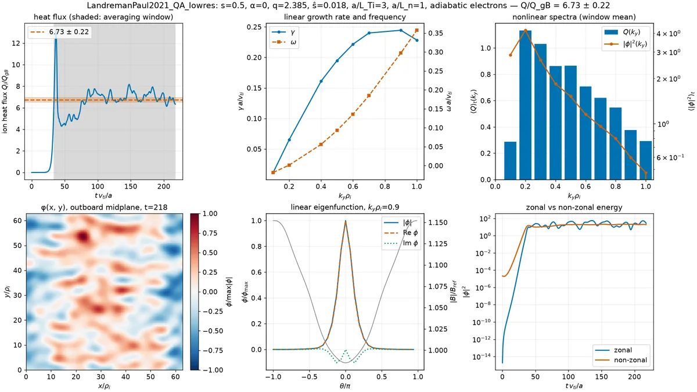

# Run a quick gyrokinetic turbulence simulation

`vmex --turbulence` solves an input (or reads a `wout_*.nc`), samples one flux tube and runs
[GKX](https://github.com/uwplasma/GKX), uwplasma's JAX gyrokinetic code, on it. It needs the
`turbulence` extra:

```console
pip install "vmex[turbulence]"        # gkx>=2.6.0; saturation_t_min needs a GKX newer than 2.9.0
vmex input.my_case --turbulence
vmex wout_my_case.nc --turbulence --outdir turb
```

Three GKX runs follow the equilibrium, each printed with its elapsed time and an estimate of the time left:

1. a linear `k_y` scan: the growth rate `γ(k_y)` and real frequency `ω(k_y)` of the dominant mode;
2. one linear run at the fastest-growing `k_y`, for the eigenfunction `φ(θ)`;
3. a nonlinear simulation. GKX stops it when the heat-flux window statistics converge
   (`run_to = "saturation"`) or at `t_max`, whichever comes first.

GKX chooses the solvers. Linear runs integrate in time and fall back to a Krylov eigensolve when the fit
is not a clean growing mode. Nonlinear runs use the adaptive CFL-controlled RK4 step.

## Flags and defaults

| Flag | Default | Meaning |
|---|---|---|
| `--turbulence-s S` | 0.5 | normalized toroidal flux of the flux tube |
| `--turbulence-alpha A` | 0 | field-line label (`α = θ* − ι ζ`) |
| `--turbulence-gradients TPRIM FPRIM` | 3 1 | `a/L_T` and `a/L_n` of every species (an ITG drive) |
| `--turbulence-kinetic-electrons` | off | kinetic electrons (`m_e/m_i = 1/3670`) on a 16 x 16 grid instead of adiabatic ones |
| `--turbulence-tmax T` | 800 | cap of the nonlinear run in `a/v_ti`; the run normally stops earlier on saturation |

Everything else is fixed to the values the GPU study below supports and lives in
`vmex.core.gk_run.TurbulenceSettings` (Python API): the `k_y` scan (`0.1` to `1`, 8 points), `96 x 96` points in
`(x, y)`, 24 points per poloidal turn and three turns, `(N_l, N_m) = (4, 8)` for the ions, `float32`, ion
collisionality `ν = 0.01`, hypercollisions, the `k_⊥` hyperdiffusion `D_hyper = 0.05` and the earliest start of
the saturation window, `t = 300`. Pass a modified `TurbulenceSettings` to `run_turbulence`, or edit the
`<case>_gkx_linear.toml` and `<case>_gkx_nonlinear.toml` decks the run writes and rerun them with `gkx run`.
`D_hyper` has no flag on purpose: it is a fixed default, changed through the API or the deck.

The run opens with everything that determines the answer: `s` and `ρ`, `α`, `q`, `ŝ`, the gradients, the
electron model, the box (`L_x`, `L_y`, `k_y,min`, `jtwist`), the grid and moments, the stepper, the stop rule and
its cap, collisions and hyperdiffusion, precision, the output path and the expected uncertainty. It ends with the
saturated `Q`, its standard error and whether it saturated.

Quantities are in GKX's gyro-Bohm units: `k_y ρ_i`, `γ a/v_ti` and `Q/Q_gB`. With adiabatic electrons the ion
particle flux is zero by construction. Every species has `n = T = 1`. The nonlinear run seeds every `(k_x, k_y)`
mode at amplitude `10⁻³`.

### What the defaults rest on

A GPU study (RTX A4000, `float32`, Cyclone-like drive `a/L_T = 3`, `a/L_n = 1`, `s = 0.5`) compared the
shaped tokamak, the circular tokamak and the Landreman-Paul QA stellarator:

| Choice | Result |
|---|---|
| `(N_x, N_y)` | stellarator QA: 64 x 64 reads 44% above 128 x 128, 96 x 96 within 7%. Tokamaks: 64, 96 and 128 agree within the seed spread. 96 x 96 is the single default. |
| `(N_l, N_m)` | `(4, 8)` is adequate; `(6, 12)` lowers `Q` by a further 8 to 14%. |
| `N_z` per turn, `D_hyper`, precision | 24 points, 0.05 and `float32` were adequate. |
| Saturation window | starting no earlier than `t = 300` instead of 800 saves 22 to 33% of the run time with the same mean. |
| Random seed | about 10% spread of `Q` on tokamaks, the largest single error. |

The printed `±` is the statistical error of one run and does not include the seed spread or the moment
truncation. A transport number for a paper needs several seeds, resolution and box-size convergence, several field
lines or a full-surface model, and a longer averaging window; GKX's documentation describes the audits.

## Output

All files go next to the input or into `--outdir`:

- `<case>_turbulence.png`: the summary figure (below). It shows the heat-flux trace with its saturated
  mean ± standard error (the error is a batch-means estimate over GKX's saturation window, or over the
  last half of the run when GKX found none), `γ(k_y)` and `ω(k_y)`, the time-averaged nonlinear `Q(k_y)`
  and `|φ|²(k_y)` spectra, a snapshot of `φ(x, y)` at the outboard midplane, the linear eigenfunction
  over `|B|`, and the zonal and non-zonal `|φ|²`.
- `<case>_turbulence_geometry.png`: `|B|`, the grad-B and curvature drifts (`gbdrift`, `cvdrift`;
  negative is bad curvature), and the metric elements `gds2`, `gds21` and `gds22` along the field
  line, in the GS2/GX normalization of `vmex.core.turbulence.gk_fieldline_geometry_from_wout`.
- `<case>_turbulence_fluxes.png`: heat and particle flux on linear and logarithmic axes (the log
  axis shows the linear phase), and the free energies `W_g` and `W_φ`.
- `<case>_turbulence.json`: settings, `q`, `ŝ`, the scan, the fluxes, GKX's saturation decision and
  the wall time.



The panels follow the figures in the stellarator gyrokinetic literature. Flux traces with a
saturated mean, `γ(k_y)` and `Q(k_y)` spectra appear in the GX papers (Mandell et al. 2024, *J. Plasma
Phys.*; Kim et al. 2024, *J. Plasma Phys.*) and in the turbulence-optimization studies built on them
(Landreman et al. 2025, *J. Plasma Phys.*). The geometry panels follow Roberg-Clark et al. (2023) and
the stella W7-X study of González-Jerez et al. (2022, *J. Plasma Phys.*).

## Cost

On an RTX A4000 in `float32` the default 96 x 96 run saturated after `t ≈ 540` to `620` in the study; at 96 x 96 a run to `t = 400` took 1 to 1.3 hours
on a shared GPU, so expect one to two hours. On a CPU one step at this resolution costs seconds and the CFL step is near 0.03, so the run takes many
hours. Kinetic electrons add 48 Hermite moments for the electrons, so they run on GKX's 16 x 16 example grid: a
32 x 32 grid exhausted host memory while compiling the IMEX stepper. The linear scan and the nonlinear run take
hours on a GPU, and the result is a coarse survey, not a converged flux.
