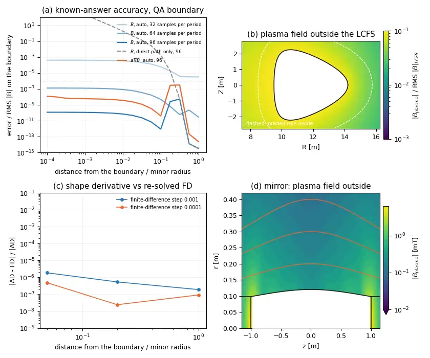

# Evaluate the field outside the plasma and its gradients

In this lesson you build the magnetic field outside a finite-beta equilibrium, read it
at points from a minor radius out to a millimetre from the boundary, check how accurate
it is, and differentiate it with respect to the point and to the boundary shape. It
runs on `pip install "vmex[coils]"` and a CPU, in about five minutes.



## Build the field

```python
import jax
import jax.numpy as jnp
import vmex as vj
from vmex import optimize as opt

jax.config.update("jax_enable_x64", True)
inp = vj.VmecInput.from_file("examples/data/input.nfp2_QA_finite_beta")
equilibrium = opt.solve_equilibrium(inp)
field = equilibrium.exterior_field()       # the plasma's own field, default settings
```

`exterior_field()` is `VmecExtender.from_equilibrium`. Beyond the plasma part it adds
`external_field`, the field of the coils: pass an ESSOS `BiotSavart` field as a callable
`xyz (n, 3) -> B (n, 3)`, or an `MgridField`. A wout file works the same way:
`vj.VmecExtender.from_file("wout_case.nc", external_field=coils.B)`. Every constructor and
parameter is listed in {doc}`/reference/exterior-field`.

The defaults are the settings to use. `digits=6` asks for a plasma field accurate to
`1e-6` of the RMS boundary field, and the source grid is sized from it and from the
aspect ratio of the boundary. `near_surface="auto"` uses the cheap direct quadrature
where it is accurate and the target-graded rule where it is not.

## Read B and its derivatives

```python
equilibrium.set_points_flux([[0.0, 0.0, 0.0], [1.0, 0.0, 0.0]])
axis, edge = equilibrium.field.get_points_cart()
ray = (edge - axis) / jnp.linalg.norm(edge - axis)
minor = float(equilibrium.wout.Aminor_p)
points = edge + (jnp.array([0.01, 0.1, 1.0]) * minor)[:, None] * ray   # 1%, 10%, 100% of a out

B = field.B(points)                    # (3, 3) tesla, Cartesian
gradB = field.gradB(points)            # (3, 3, 3): dB_i/dx_j
hessian = field.gradgradB(points)      # (3, 3, 3, 3)
```

All components and derivative axes are Cartesian. `gradgradgradB` gives the third order.
Without arguments the methods read the points stored by `set_points_xyz` or
`set_points_cyl`, the way the interior field does.

## Check the accuracy

```python
estimate = field.B_error_estimate(points)    # relative to the RMS |B| on the boundary
```

On this equilibrium the estimate at the three points is about 1e-12, 2e-10 and 2e-8, all
below the requested `1e-6`. Without the graded rule the same points are wrong by a factor of
145 at 1% of the minor radius and by 130% at 10%; at one minor radius the two rules agree to
`5e-15`. The estimate is what the default `accuracy_check="warn"` compares with `10**-digits`
on every eager call. It tracks the true error rather than bounding it, and `-log10` of it is the
achieved number of digits. Where it is above the request, the quadrature is limited by the
boundary samples, not by the rule: raise `nphi` and `ntheta`.

Panel (a) of the figure uses a harder test with an exact answer. The boundary field of the same
QA surface is replaced by that of a current filament on the magnetic axis, a source only one
minor radius from the surface. With 32 samples per period (this lesson's default) the field is
then good to `4e-4` next to the boundary and the estimate says so; at 64 samples it is good to
`2e-6` and at 96 to `3e-9`, from 1e-4 of a minor radius to one, while the direct rule
alone is off by orders of magnitude within 10% of the minor radius.

```python
field = equilibrium.exterior_field(nphi=96, ntheta=96, accuracy_check="raise")
```

`accuracy_check="raise"` stops a script at the first point that misses `10**-digits`.

## Choose the quadrature

```python
field.near_surface = "direct"        # the direct rule alone: fast, wrong near the boundary
field.near_surface = "graded"        # the graded rule at every point
near = field.with_graded_quadrature()  # a copy that does the same, for jit and field lines
fast = field.with_graded_quadrature(nodes=(64, 128))   # fewer nodes: faster, less accurate
```

Use `"auto"` unless every target is known to be near the boundary (a field-line trace that
starts a millimetre out) or known to be far from it. The graded rule costs a few milliseconds
per point, about ten times the direct rule, and `"auto"` pays that only where the estimate
says it must. Under `jit` the choice is made inside the traced function, so the same
default works in `jax.jit(field.B)`.

## Differentiate in the points

`B`, `gradB`, `gradgradB` and `gradgradgradB` are JAX functions of the points:

```python
absB = lambda p: jnp.linalg.norm(field.B(p), axis=-1)
slope = jax.grad(lambda p: absB(p).sum())(points)    # d|B|/dx at each point, (3, 3)
fast_B = jax.jit(field.B)                            # the default also traces
```

`gradB` and the higher orders come from the closed-form layer kernels of the same quadrature, in
one pass for all orders, so they and `B` differentiate one function.

## Differentiate in the boundary shape

A field built from a problem carries the vector-Jacobian products of `B` and its derivatives
in the boundary modes, and in external parameters such as coil modes:

```python
problem = opt.VmecProblem.from_input(inp, max_mode=1, use_ess=True)
field = problem.exterior_field(problem.x0).set_points_xyz(points)
print(field.dof_names)                   # RBC(1,0), RBC(-1,1), ... ZBS(1,1)
gradient = field.B_vjp(jnp.ones_like(field.B()))      # d(sum B)/d(mode), shape (8,)
```

`B_vjp`, `gradB_vjp`, `gradgradB_vjp` and `gradgradgradB_vjp` take a cotangent with the shape
of the output. No equilibrium is re-solved: the pullback goes through the implicit adjoint of the
solve and through the quadrature that the field is using. The adjoint costs one linear solve per
call and the quadrature is differentiated at the points you stored, so the cost does not grow
with the number of modes.

`examples/vmex_get_B_outside_plasma.py` runs this at one point with ESSOS coil modes as extra
degrees of freedom: pass `external_parameters`, `external_field_from_parameters` and
`external_dof_names`, and the vector returned by each `*_vjp` method has the boundary modes
first and the coil modes after them.

### Check it

Panel (c) of the figure repeats the check on the QA deck above. For a random direction in the
eight modes of `max_mode=1` it compares `B_vjp` with central differences of equilibria
re-solved at `x0 +- h d`, at 5%, 20% and 100% of a minor radius out. The relative difference is
`2e-6` or below with `h = 1e-3` and `6e-7` or below with `h = 1e-4`, the truncation and the
round-off of the difference quotient. The graded rule holds its grading centre, the nearest
boundary point of each target, fixed under differentiation; the agreement at 5% shows that this
costs nothing at that distance.

## A mirror

An open mirror has a boundary that is not a torus, and the same question has a different
answer: `examples/mirror/mirror_exterior_field.py` closes the boundary of a fixed-boundary mirror
with its two end planes, takes the total field on that closed surface from
`solve_mirror(...).mout()`, and evaluates with `virtual_casing_jax.mirror.MirrorExteriorField`
the field of the currents inside it at points outside (panel d). With `branch="external"` the
same surface gives the field of the coils inside the plasma. The script reports the net flux
defect, which is zero for a solenoidal field, traces field lines of the exact vacuum field plus
the plasma field, and writes `summary.json`. Equilibria with anisotropic pressure are not
covered.

## Where next

- {doc}`/reference/exterior-field`: every constructor, parameter and method.
- {doc}`/howto/use-essos-fields-and-coils`: coils, tabulation and field-line tracing.
- {doc}`/explanation/nestor-vacuum`: the quadratures and their measured accuracy.
- {doc}`/howto/trace-to-the-wall`: guiding centres through the exterior field.
